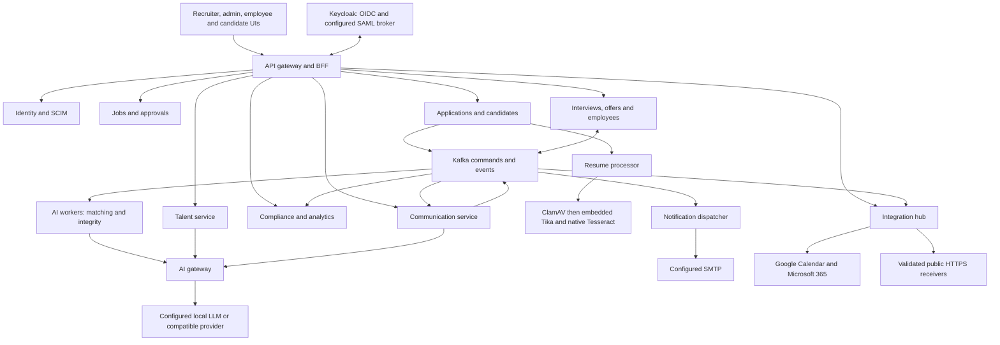
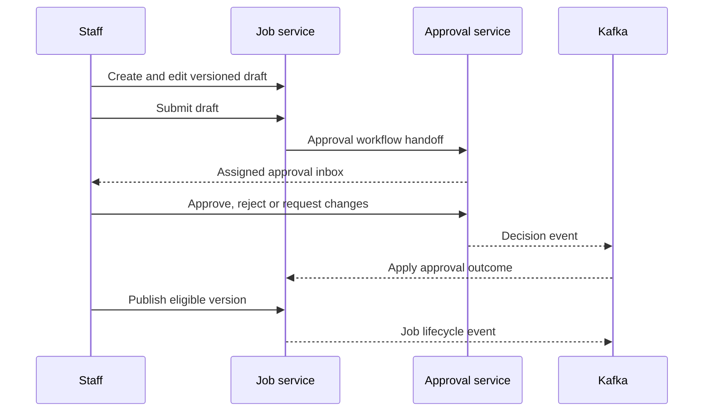
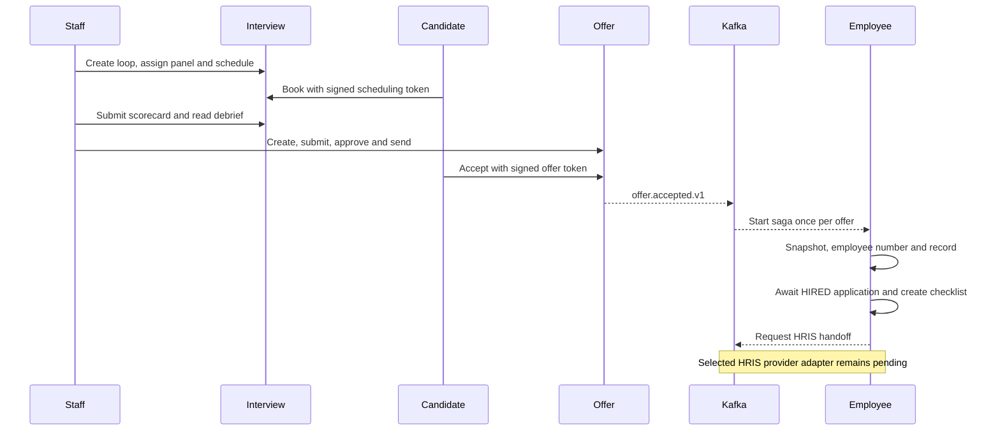

# OpenHire — end-to-end backend design

Implemented service map at the 2026-10-16 source checkpoint. A dependency arrow represents a call/event boundary, not shared database access or a distributed transaction. See the [service index](README.md) for all designs and complete endpoint contracts.

## Platform context

Mongo databases are service-owned. Redis supports sessions, caches, locks and throttles where configured. Kafka carries asynchronous facts/commands. Services use APIs/events rather than querying another service's collections to bypass its ownership or authorization.

## Staff authentication and tenant identity

1. Browser checks the BFF session and starts OIDC login when unauthenticated. Gateway owns browser sessions/token relay; identity-service owns organizations/members.
2. Keycloak authenticates. Configured SAML uses pre-linked tenant users; SCIM is a separate machine provisioning flow.
3. Tenant context comes from verified identity. Backend checks must not trust an arbitrary client-supplied tenant header.
4. Cookie-authenticated changes retain CSRF protection. Dedicated MCP/SCIM paths use stateless bearer authentication and audience/scope checks.
5. Role, resource ownership, public capability token and internal-secret checks are separate. A valid JWT is not cross-tenant access.

## Requisition to publication

Job versions and approval requests are separate aggregates. Submitted does not mean publicly open. AI drafts are editable content; human submission/approval/publication remain explicit.

## Apply, scan, assess and review

1. Application intake validates source permissions, open job, consent, idempotency and job snapshot. Sources include staff, public candidates, agencies, employees and validated API keys.
2. Candidate-service resolves identity. Resume-processor quarantines, scans and extracts documents; scanner outages/unknown results fail closed.
3. Application workflow reacts to processed resumes and requests assessments. AI workers fetch evidence, calculate results and publish outcomes; integrity signals require review.
4. Projection updates preserve newer human decisions against delayed worker updates. AI outages can produce explicit partial results with durable retry, not fabricated complete evidence.
5. Staff shortlist/reject/override with required rationale. Candidate receipts only authorize the candidate-facing application surfaces.

## Interview to onboarding

Interview-calendar synchronization is optional/asynchronous. Offer acceptance is independent of a certified external e-sign provider. Hire-saga state is persisted for inspection/retry; do not recreate an employee to recover a delayed HRIS result.

## Communication and operational feedback

Communication-service owns content/preferences and requests delivery. Notification-dispatcher enforces quiet hours, throttle and channel fallback, calls configured SMTP and publishes outcomes. The UI distinguishes queued messages from SENT/FAILED results. SMS/WhatsApp enum values do not imply working provider adapters.

Compliance consumes audit/provenance and coordinates privacy/retention with owner services. Analytics builds projections and health/SLO/lag/dead-letter views, labelling approximate/local-fallback indicators. Replay is scoped and audited rather than blindly resending all events.

## API and security conventions

| Boundary | Credentials/context | Constraint |
| --- | --- | --- |
| Staff browser | BFF session, OIDC and mutation CSRF | Service role/resource checks still apply |
| Candidate application | `X-Application-Receipt`, tenant/application | Public URL does not mean unrestricted data access |
| Candidate interview | `X-Scheduling-Token` | Signed capability, not a staff session |
| Candidate offer | `X-Offer-Token` | Keep credentials out of request URLs/logs |
| Internal services | `X-Internal-Service-Secret`, tenant as specified | Never put internal credentials in frontend code |
| Machine intake | Identity-validated API key and scope | Tenant is derived from credential |
| MCP | Audience plus integrations read/write scopes | Writes also require same-admin human approval |
| SCIM | SCIM audience/scope and fixed tenant | No role/password/group provisioning escalation |

`Authentication` in Java signatures is framework-supplied, not request JSON. Binding annotations specify path/query/header/body placement and defaults. Record fields describe JSON DTOs. Map-based response keys are defined by the linked handler, not inferred from a generic type.

POST does not always mean 201: commands often return 200, asynchronous starts 202 and explicit no-content commands 204. Common failure classes are validation 400, authentication/authorization 401/403, missing resources 404, conflicts 409 or conditional-write 412, and quota 429. Exact exception translation is service-specific. Dependency errors are not successful business outcomes.

## Consistency and recovery

- Optimistic versions protect local updates; there is no global ACID transaction.
- Outbox/relay patterns reduce state/event divergence where implemented. Do not assume every remote call and audit event share one atomic commit.
- Kafka is at-least-once. Tenant identity, deduplication and persisted work state handle replays; external side effects may still require reconciliation.
- Privacy tombstones prevent late work from recreating erased artifacts; legal holds and retention remain owner-service concerns.
- Encrypted Mongo recovery restores into isolated namespaces. Full-platform recovery also needs Keycloak, Kafka, Redis/session strategy, resume storage and keys. See [recovery scope](../PHASE_8_ENTERPRISE_RECOVERY.md).

Module inventory: [settings.gradle](../../settings.gradle). Routes: [gateway configuration](../../api-gateway/src/main/resources/application.yml). Ports/URLs/flags: each service `application.yml` and [Compose](../../docker-compose.yml); host and process ports may differ.

Documentation completion does not close live identity/provider certification, scanner/resource acceptance, additional adapters, seat/storage quota or coordinated DR gaps. This task did not start services or rerun runtime acceptance.
