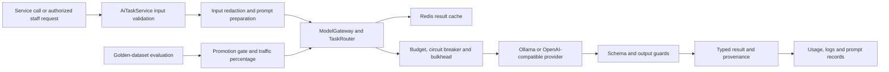

# AI gateway

Central boundary for embedding, evidence judging, resume structuring, job-description drafting, message drafting, natural-language filters and fit explanations. It owns model routing, guardrails, prompts, evaluations, cost/usage records and request provenance. It does not decide whether a person is hired or rejected.

## End-to-end design

## Use-case details

- Internal task endpoints require `X-Internal-Service-Secret` and `X-Tenant-Id`. Do not expose these through a public browser route or put the secret in frontend code.
- Embedding accepts 1–64 input strings, each up to 8,000 characters. Task-specific checks also bound supplied chunks and resume text.
- Model output is parsed/validated and evidence references checked. Redaction/guardrails and output provenance are part of the service response path, not a substitute for human review.
- Staff job drafting is allowed for recruiter, hiring-manager, HR-admin, organization-admin and super-admin roles. Settings/evaluation/promotion/ops are admin functions; compliance officers can read prompts.
- Evaluation starts asynchronously with 202 and is polled by evaluation-run ID. Promotion applies evaluation gates and optional traffic percentage rather than blindly replacing a prompt.
- Log retention is an internal-only endpoint, supports dry-run/bounded batches and rejects live cutoffs newer than one month. Privacy/legal-hold orchestration is described in compliance operations.

## REST contract

[Complete reference](ai-gateway-endpoints.md): **18 operations**, including request/response records from `AiViews`, prompt settings and evaluation views.

| API group | Paths | Purpose |
| --- | --- | --- |
| Internal tasks | `POST /api/v1/internal/ai/{embed,judge,structure-resume,jd-draft,message-draft,nl-filter,explain-fit}` | Typed service-to-service AI tasks; each suffix has its own payload schema |
| Staff draft | `POST /api/v1/jobs/ai-draft` | `JdRequest` → guarded draft |
| Tenant settings | `GET/PUT /api/v1/ai-settings` | Read/change model and budget policy |
| Prompts | `GET /api/v1/prompts`, `GET /api/v1/prompts/{id}` | Versioned prompt metadata/content |
| Evaluation | `POST /api/v1/prompts/{id}/evaluate`; `GET /api/v1/eval-runs/{id}` | 202 run start; status, checks and case results |
| Promotion | `POST /api/v1/prompts/{id}/promote` | Optional `{trafficPct}`; guarded promotion |
| Operations | `GET /api/v1/ai/ops-summary?range=24h` | Usage/failure/cost summary |
| Retention | `GET /api/v1/internal/ai/log-retention/tenants`; `POST /api/v1/internal/ai/log-retention` | Internal `{tenantId,cutoff,dryRun,limit}` batch workflow |

Example embedding body: `{"inputs":["Java and Spring backend experience"],"inputType":"document"}`. Consult the configured provider/model for supported embedding semantics; this example does not select a live model or validate credentials.

## Components and purpose

| Component | Purpose |
| --- | --- |
| `AiTaskService` | Prepare and validate the seven task types, shape results |
| `ModelGateway`, `TaskRouter` | Select models/providers and coordinate calls |
| `InputGuard`, `ProtectedAttributes`, `SchemaValidator`, `OutputGuard` | Bound/redact input and reject unsupported output/evidence |
| `CircuitBreaker`, `Bulkhead`, `ProviderGuards` | Isolate unavailable/overloaded providers |
| `CostMeter`, usage store | Record/enforce configured usage policy |
| `PromptRegistry`, `PromptAdminService`, `EvaluationService`, `EvalGates` | Prompt lifecycle, evaluation and promotion |
| Ollama / OpenAI-compatible adapters | Convert provider-specific HTTP to application ports |
| Redis result cache | Reuse eligible task results |
| Mongo stores and `ProvenanceWriter` | Prompts, evaluations, settings, usage and request provenance |

Patterns: strategy/provider adapter, ports/adapters, cache-aside, circuit breaker, bulkhead, policy guards and evaluation-gated rollout. Model unavailability must be reported or explicitly degraded by the calling service, not replaced with invented evidence.

Source: [service](../../ai-gateway/src/main/java/com/openhire/aigateway), [configuration](../../ai-gateway/src/main/resources/application.yml), [tests](../../ai-gateway/src/test). Local LLM operation still requires the configured model to be installed and reachable; no model execution was performed for this documentation update.
