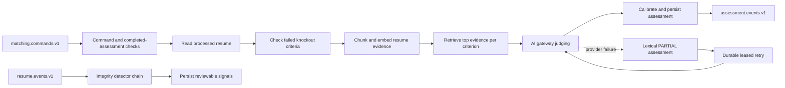

# AI workers

Runs asynchronous matching assessments and integrity signals. Both capabilities currently live in the **same executable module**. There is no separate deployed `integrity-worker` module in `settings.gradle`; diagrams must not imply that the planned split already exists.

## End-to-end design

## Business rules

Matching checks privacy tombstones, processed commands and existing COMPLETE results before doing work. The resume must be ready. Failed knockouts produce a not-eligible assessment; they do not directly mutate the application. Semantic processing chunks text, embeds/caches evidence, retrieves the top five evidence chunks per criterion, judges and calibrates results. A semaphore bounds concurrent AI chains.

Provider failure records a lexical PARTIAL result and schedules a persisted retry. A later COMPLETE assessment can supersede the partial result; exhausted retries remain observable. The worker never turns a model recommendation directly into an application hiring decision.

Integrity processing includes duplicate identity, timeline overlap, injection-attempt and AI-text-likelihood signals. These are review signals, not proof of dishonesty or automatic rejection. A staff dismissal requires a reason and records the actor/time. Privacy tombstones prevent late matching commands from recreating erased candidate artifacts.

## REST and asynchronous contracts

[Complete REST reference](ai-workers-endpoints.md): **2 directly declared operations**.

| Method/path | Input / access | Response |
| --- | --- | --- |
| `GET /api/v1/integrity/signals` | Staff; required `applicationId` query | Signal list: IDs, type, severity, confidence, reason, status and timestamps |
| `POST /api/v1/integrity/signals/{id}/dismiss` | Staff; `{reason}` | Updated signal with dismissal actor/reason/time |

Matching is **not** a synchronous REST endpoint in this module. `MatchingCommandListener` consumes `matching.commands.v1`; the retry scheduler resumes due jobs. `IntegrityListener` consumes `resume.events.v1`. Event and domain request types are defined in the [source](../../ai-workers/src/main/java/com/openhire/aiworkers); callers must preserve tenant, command/event IDs, application/resume identity and job/rubric versioning.

## Components and purpose

| Component | Purpose |
| --- | --- |
| `MatchingService` | Orchestrate matching stages, partial fallback and retry |
| `Chunker`, `Lexical`, `Retrieval`, `Calibration` | Evidence segmentation, lexical coverage, vector retrieval and score shaping |
| Assessment/chunk/criterion-vector/retry ports | Separate calculations from durable storage and transport |
| HTTP resume/AI adapters | Read processed text and call AI gateway without sharing another database |
| `IntegrityService`, detector implementations | Produce explainable review signals |
| `MongoIdentityIndex`, signal store | Tenant-scoped identity matching and signal persistence |
| Matching listener/retry scheduler | Event-driven work and leased retries across instances |
| Mongo outbox support | Emit committed assessment changes for application/talent consumers |

Patterns: staged processing pipeline, detector strategy/chain, idempotent consumer, cache/reuse, bounded bulkhead, lease-based retry and explicit degraded output. At-least-once Kafka delivery requires deduplication; it is not a guarantee that every external model call runs exactly once.

Source: [configuration](../../ai-workers/src/main/resources/application.yml), [matching code](../../ai-workers/src/main/java/com/openhire/aiworkers/matching), [integrity code](../../ai-workers/src/main/java/com/openhire/aiworkers/integrity), [tests](../../ai-workers/src/test). Verify queue progress, PARTIAL/COMPLETE status and retry exhaustion separately from HTTP health.
