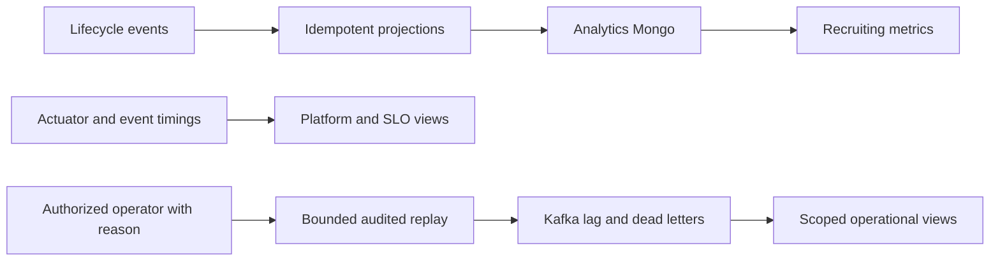

# analytics-service

## Current design and detailed contract

[Complete REST endpoint reference](analytics-service-endpoints.md) includes current request bindings, response DTOs and source links. See [platform end-to-end flows](END_TO_END_DESIGN.md) and [component purposes](SHARED_COMPONENTS.md). Older phase-specific verification notes below are historical; this documentation refresh does not claim new runtime acceptance.

## Business responsibilities

Build tenant-scoped recruiting metrics from events; expose platform health and service-level indicators; inspect
redacted dead letters and provide bounded, audited replay. The service does not query other services' databases.

## REST endpoints

All paths are prefixed by `/api/v1`; the machine-readable contract is
[`phase7-api.openapi.json`](../../contracts/phase7-api.openapi.json).

| Method | Path | Business logic |
|---|---|---|
| GET | `/analytics/kpis` | Time to hire, offer acceptance, AI agreement and cost |
| GET | `/analytics/funnel` | Counts of applications reaching each stage |
| GET | `/analytics/time-to-hire` | Weekly median time to hire |
| GET | `/analytics/sources` | Source applicants, shortlist rates and hires |
| GET | `/analytics/ai-overrides` | Human override reason counts |
| GET | `/analytics/stage-latency` | Median and p90 stage timings |
| GET | `/platform/services` | Super-admin service health observations |
| GET | `/platform/slo` | Org-admin tenant or super-admin cross-tenant indicators |
| GET | `/platform/consumers` | Super-admin Kafka consumer lag |
| GET | `/admin/dlq`, `/admin/dlq/{id}` | Redacted dead letters scoped by operator access |
| POST | `/admin/dlq/{id}/replay` | Reason-required replay; duplicate conflicts, super-admin force override |
| POST | `/admin/dlq/replay` | Bounded batch replay or non-mutating dry run |

Analytics reads support `range=30d|90d|1y` and optional `jobId`.
Org admins cannot inspect another tenant's dead letters; unattributed messages are super-admin only.

## Patterns and components

- Hexagonal architecture separates controllers, Kafka/HTTP/Mongo adapters and domain calculations.
- CQRS/materialized views: `ProjectionService` consumes events; `AnalyticsQueryService` reads Mongo facts.
- Idempotent consumers: event claims protect projections against duplicate deliveries.
- Safeguarded command handling: `DeadLetterService` applies operator scope, replay limits and audit recording.
- Scheduled polling: `HealthPollService` reads actuator endpoints; `PlatformQueryService` combines health and event timings.
- Kafka AdminClient supplies consumer lag; Kafka consumers inspect dead-letter topics; Kafka producers replay original records.
- Shared audit recorder sends replay actions through the durable audit outbox.

## Verification and boundaries

Unit/controller/architecture tests cover projections, math, access, redaction and replay.
`OPENHIRE_RUN_MONGO_TESTS=true` enables isolated Mongo tests and the Spring context test with the real audit bean.
The protected `/api/v1/internal/platform/metrics` exporter emits only low-cardinality rolling SLO gauges.
`MonitoredSlos` reads fresh values from the configured Prometheus API; absent, stale (over 120 seconds),
invalid or unavailable values produce an explicitly labelled local fallback. Tenant selectors are escaped and
separate from the global scope. Collection still uses actuator health samples and event timestamps, so API
latency remains explicitly approximate rather than a histogram percentile.
See [low-memory operations](../PHASE_7_OPERATIONS.md) for the optional 192 MB monitoring profile.
See [Phase 7 evidence and remaining acceptance](../PHASE_7.md).
