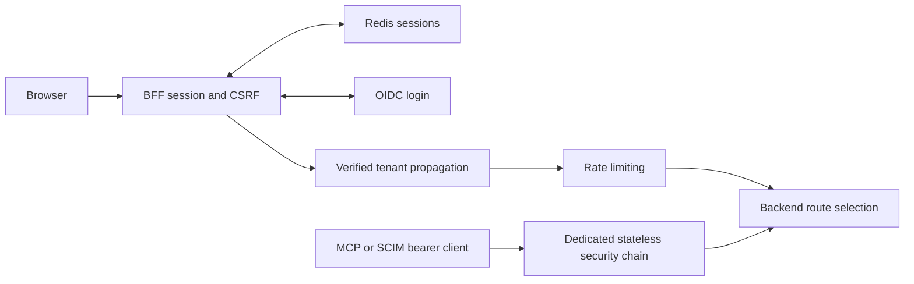

# API gateway

## Current design and detailed contract

[Complete REST endpoint reference](api-gateway-endpoints.md) includes current request bindings, response DTOs and source links. See [platform end-to-end flows](END_TO_END_DESIGN.md) and [component purposes](SHARED_COMPONENTS.md). Older phase-specific verification notes below are historical; this documentation refresh does not claim new runtime acceptance.



The owned-endpoint reference does not enumerate proxy routes: [application.yml](../../api-gateway/src/main/resources/application.yml) defines route predicates, rewrites and backend URLs. MCP and SCIM have separate stateless bearer chains; ordinary browser mutations retain CSRF protection. Do not treat an internal service endpoint as browser-accessible solely because its controller exists.


## Purpose

The API gateway is the only browser-facing backend entry point in Phase 1. It acts as a Backend for Frontend, keeps authentication tokens out of browser storage, stores browser sessions in Redis, resolves tenant identity, validates API keys, applies rate limits, and routes allowed requests to the identity service.

The gateway is implemented with Java 25, Spring Boot 4.1.1, Spring Cloud Gateway, WebFlux, Spring Security, Spring Session, and reactive Redis. It listens on port `8080` by default.

## Service boundary

The gateway is responsible for:

- Starting staff and candidate OIDC Authorization Code login flows.
- Maintaining the browser session in Redis through an `HttpOnly` cookie.
- Returning session and CSRF information to the frontend.
- Invalidating browser sessions on logout and closing the Keycloak SSO session.
- Serving the current-user profile and indexed browser-session management endpoints.
- Reading tenant and actor claims from authenticated JWTs.
- Removing bearer tokens before forwarding internal requests.
- Validating `X-API-Key` credentials through the identity service.
- Caching successful API-key validation for five minutes.
- Applying Redis token-bucket limits per tenant or public client.
- Routing Phase 1 identity paths to the identity service.

The gateway does not own organization, user, role, invitation, API-key, or SSO records.

## Architecture and project layers

```text
com.openhire.gateway
├── web
│   └── BffSessionController
├── security
│   ├── GatewaySecurityConfiguration
│   ├── ApiKeyAuthenticationFilter
│   └── TenantPropagationFilter
└── config
    └── GatewayConfiguration
```

Gateway processing is reactive. Global filters enrich or reject the request before Spring Cloud Gateway evaluates the configured route and forwards the request.

## Business logic

### Browser session flow

1. The frontend redirects staff users to `/oauth2/authorization/openhire-staff` or candidates to `/oauth2/authorization/openhire-candidate`.
2. Spring Security starts Authorization Code login against the configured Keycloak realm.
3. Keycloak requires PKCE with the `S256` challenge method.
4. The authorization callback is handled at `/login/oauth2/code/{registrationId}`.
5. Authorized-client tokens remain on the server side.
6. Spring Session stores session state in Redis under the `openhire:sessions` namespace.
7. The browser receives the `OPENHIRE_SESSION` cookie with `HttpOnly` and `SameSite=Lax`.
8. The frontend reads `/bff/session` to receive its normalized user, tenant, roles, permissions, active role, and expiry.
9. The frontend reads `/bff/csrf` once after session discovery so Spring writes the `XSRF-TOKEN` cookie used by mutations.

Production should set `SESSION_COOKIE_SECURE=true` so the cookie is transmitted only over HTTPS.

### JWT tenant propagation

For an authenticated resource-server request, `TenantPropagationFilter`:

1. Reads `organization_id`, falling back to `tenant_id`.
2. Sets the trusted internal `X-Tenant-Id` header.
3. Sets `X-Actor-Id` from the JWT subject.
4. Removes the external `Authorization` header before forwarding.

This prevents downstream services from depending directly on the external token representation.

### API-key authentication

When `X-API-Key` is present:

1. Hash the complete presented key to create a Redis cache key.
2. Read cached tenant and scopes from `openhire:api-key:{hash}`.
3. On a cache miss, call the identity service internal validation endpoint with `X-Internal-Secret`.
4. Cache a successful result for five minutes.
5. Remove `X-API-Key` before forwarding.
6. Add trusted `X-Tenant-Id` and `X-Api-Key-Scopes` headers.
7. Return `401 Unauthorized` when validation fails.

The raw API key is never stored in the gateway cache key or forwarded downstream.

### Rate limiting

The gateway uses Spring Cloud Gateway's Redis rate limiter:

- Replenishment rate: 20 requests per second.
- Burst capacity: 40 requests.
- Requested tokens: one per request.
- Primary key: `X-Tenant-Id`.
- Public fallback key: remote client address.

The response includes rate-limit headers such as remaining tokens, burst capacity, and replenishment rate.

### Routing

Phase 1 paths are routed to `${IDENTITY_SERVICE_URL}`, which defaults to `http://localhost:8081`. Route predicates prevent the internal API-key validation endpoint from being exposed as a normal public gateway route.

## REST endpoint list

### Gateway-owned endpoints

| Method | Endpoint | Authorization | Business operation |
|---|---|---|---|
| `GET` | `/bff/session` | Optional session | Return the frontend session contract (user, tenant, roles, permissions, active role, expiry), or `authenticated: false` |
| `GET` | `/bff/csrf` | Session | Return the CSRF header name and token |
| `DELETE` | `/bff/session` | Session | Invalidate the current Redis-backed session |
| `GET` | `/bff/logout` | Optional session | Revoke the current BFF/provider sessions and redirect to the configured sign-in page |
| `GET/PATCH` | `/api/v1/me` | Session | Read or update the current profile stored with the BFF session |
| `GET/DELETE` | `/api/v1/me/sessions` | Session | List principal sessions or revoke every session except the current browser |
| `GET` | `/oauth2/authorization/openhire-staff` | Public | Start staff Authorization Code login |
| `GET` | `/oauth2/authorization/openhire-candidate` | Public | Start candidate Authorization Code login |
| `GET` | `/login/oauth2/code/{registrationId}` | Keycloak callback | Complete the authorization callback |
| `GET` | `/actuator/health` | Public | Return service health and probe groups |

OAuth authorization and callback endpoints are provided by Spring Security rather than a custom controller.

### Proxied identity routes

The gateway routes these path groups to the identity service:

| Route pattern | Business area |
|---|---|
| `/api/v1/platform/**` | Organizations, quotas, and break-glass administration |
| `/api/v1/users/**` | Team members and role assignments |
| `/api/v1/roles/**` | Roles and permissions |
| `/api/v1/invites/**` | Invitation administration |
| `/api/v1/public/**` | Public invitation and verification completion |
| `/api/v1/api-keys/**` | API-key administration |
| `/api/v1/setup/**` | Organization setup progress |
| `/api/v1/auth-policy/**` | Authentication policy |
| `/api/v1/sso-config/**` | SSO configuration |

The detailed operation list for these routes is maintained in [Identity service](identity-service.md).

## Request-processing order

```text
Browser or API client
        |
        v
Spring Security authentication
        |
        v
API-key filter order -100
  cache lookup or identity validation
        |
        v
Tenant propagation filter order -50
  JWT tenant and actor headers
        |
        v
Redis token-bucket rate limiter
        |
        v
Route predicate and identity-service proxy
```

API-key processing runs before JWT tenant propagation. If no API key is supplied, the filter passes the exchange unchanged.

## Design patterns

| Pattern | Usage |
|---|---|
| API Gateway | Provides one controlled entry point and central cross-cutting policies |
| Backend for Frontend | Owns browser session behavior and prevents token storage in frontend JavaScript |
| Filter chain | Ordered reactive filters authenticate and enrich requests before routing |
| Cache-aside | API-key validation checks Redis first and calls identity only on cache miss |
| Token bucket | Redis rate limiter controls sustained and burst traffic |
| Claim-to-context mapping | Converts JWT claims into trusted tenant and actor headers |
| Credential stripping | Removes bearer and API-key credentials before downstream forwarding |
| Strategy by configuration | `local` and `oidc` modes select different security chains |
| Externalized configuration | Ports, issuers, secrets, routes, and cookie security are environment controlled |
| Fail closed | API-key validation errors produce `401` instead of forwarding an untrusted request |

## Components used

### Application components

| Component | Responsibility |
|---|---|
| `ApiGatewayApplication` | Spring Boot entry point |
| `BffSessionController` | Session inspection, CSRF token delivery, and logout |
| `GatewaySecurityConfiguration` | Local and OIDC reactive security chains |
| `ApiKeyAuthenticationFilter` | API-key cache lookup, identity validation, credential removal, and trusted headers |
| `TenantPropagationFilter` | JWT tenant/actor extraction and bearer-token removal |
| `GatewayConfiguration` | Reactive `WebClient` and tenant rate-limit key resolver |

### Framework and infrastructure components

| Component | Technology | Responsibility |
|---|---|---|
| Route engine | Spring Cloud Gateway WebFlux | Matches configured paths and proxies reactive HTTP requests |
| Security | Spring Security OAuth2 client and resource server | OIDC login and JWT authentication |
| Session store | Spring Session Data Redis | Persists BFF sessions outside the gateway process |
| Rate limiter | Spring Cloud Gateway Redis rate limiter | Applies per-tenant token buckets |
| Validation client | Spring reactive `WebClient` | Calls identity-service API-key validation |
| Keycloak realms | Keycloak | Staff and candidate login, PKCE, TOTP, verification, and reset flows |
| Actuator | Spring Boot Actuator | Health, liveness, readiness, metrics, and operational endpoints |

## Security modes

### Local mode

- Default mode for local development.
- Permits requests without Keycloak.
- Still exercises routing, MongoDB, Redis rate limiting, tenant headers, and API-key validation.
- Must not be used in production.

### OIDC mode

Activate with:

```bash
export SPRING_PROFILES_ACTIVE=oidc
export SECURITY_MODE=oidc
```

OIDC mode:

- Permits health, public identity paths, OAuth entry points, and login callbacks.
- Requires authentication for other requests.
- Configures staff and candidate Keycloak providers.
- Supports JWT resource-server requests.

## Redis data

| Key or namespace | Value | Lifetime |
|---|---|---|
| `openhire:sessions` | Spring Session records | Default session timeout of 30 minutes |
| `openhire:api-key:{sha256}` | Validated organization and scopes | Five minutes |
| Gateway rate-limiter keys | Token-bucket state | Managed by Spring Cloud Gateway |

## Configuration

| Variable | Default | Purpose |
|---|---|---|
| `GATEWAY_PORT` | `8080` | Browser-facing port |
| `IDENTITY_SERVICE_URL` | `http://localhost:8081` | Identity route and API-key validation target |
| `REDIS_HOST` | `localhost` | Session, cache, and rate-limit store |
| `REDIS_PORT` | `6379` | Redis port |
| `SESSION_COOKIE_SECURE` | `false` | Enables HTTPS-only browser cookies |
| `INTERNAL_SERVICE_SECRET` | Local development value | Authenticates gateway-to-identity validation calls |
| `SECURITY_MODE` | `local` | Selects local or OIDC security chain |
| `SPRING_PROFILES_ACTIVE` | None | Set to `oidc` for Keycloak client registrations |
| `STAFF_OIDC_ISSUER` | Local staff realm | Staff issuer discovery URL |
| `CANDIDATE_OIDC_ISSUER` | Local candidate realm | Candidate issuer discovery URL |
| `STAFF_OIDC_CLIENT_ID` | `openhire-web` | Staff BFF client |
| `STAFF_OIDC_CLIENT_SECRET` | Placeholder | Staff BFF credential; replace before OIDC use |
| `CANDIDATE_OIDC_CLIENT_ID` | `openhire-candidate-web` | Candidate BFF client |
| `CANDIDATE_OIDC_CLIENT_SECRET` | Placeholder | Candidate BFF credential; replace before OIDC use |

## Failure behavior

| Condition | Result |
|---|---|
| Invalid API key | `401 Unauthorized` |
| Identity validation failure while authenticating an API key | `401 Unauthorized` |
| Missing tenant on a downstream tenant endpoint | Identity service returns `400 Bad Request` |
| Rate limit exhausted | Gateway returns `429 Too Many Requests` |
| Unauthenticated protected request in OIDC mode | Spring Security starts login or returns an authentication error |
| Identity service unavailable | Gateway returns an upstream service error |

## Verification status

- Java 25 clean build succeeds.
- Local profile starts without requiring Keycloak online.
- Health endpoint returns `UP`.
- Redis rate-limit headers were verified through the gateway.
- Identity routes were verified end to end.
- Valid API keys return `200`; invalid API keys return `401`.
- Full OIDC browser acceptance requires the staff and candidate Keycloak realms to be running.
