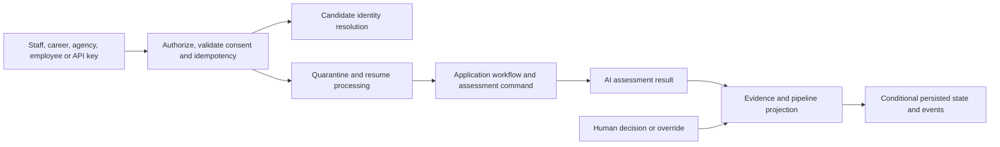

# Application service — Phase 3

## Current design and detailed contract

[Complete REST endpoint reference](application-service-endpoints.md) includes current request bindings, response DTOs and source links. See [platform end-to-end flows](END_TO_END_DESIGN.md) and [component purposes](SHARED_COMPONENTS.md). Older phase-specific verification notes below are historical; this documentation refresh does not claim new runtime acceptance.

Java 25 / Spring Boot 4.1.1, port 8084, host MongoDB oh_application.

## Business logic and components

SubmissionController authorizes source-specific requests and maps the UI contract to SubmissionService.
The service validates name/email/consent, requires an OPEN job, snapshots that job version, deduplicates
commands and coordinates candidate resolution and resume processing. Workers own processing stages;
people own shortlist/rejection/eligibility/override decisions. Revision-conditional updates prevent workers
or concurrent edits from overwriting a newer human decision.

Source rules: recruiter/admin staff; agency role plus active per-job assignment; employee role for referrals
and internal applications; internal applicant email must match the JWT; public career needs explicit consent
and a receipt; machine intake validates an identity-service API key with applications:write scope.
No caller-supplied tenant header overrides a verified token or validated API-key tenant.

Components:
- SubmissionService: normalization, lifecycle, keyword screening, worker leases, projection repair.
- SubmissionController: recruiter, career, partner and employee endpoints.
- ApiIntakeController: live API-key validation and machine submissions.
- BulkImportController: strict CSV/ZIP parsing, durable manifest/row staging and asynchronous row workers.
- CandidateMergeConsumer: tenant-scoped idempotent reassignment after a reviewed merge.
- ResumeOutcomeConsumer: wakes only the matching current resume's waiting workflow.
- Shared security/internal HTTP client/indexes/outbox; Spring MVC, MongoTemplate, Kafka, Jackson 3 and Actuator.

The earlier IntakeController/IntakeService and their ports/adapters remain a compatibility foundation.
They use applications; the complete workflow uses submissions. Existing records are not deleted/migrated.

## REST endpoint list

Prefix /api/v1. Staff routes require recruiter/admin permissions in OIDC mode.

| Method | Path | Business behaviour |
|---|---|---|
| POST | /applications | Multipart or JSON intake; mandatory Idempotency-Key; authorized source |
| GET | /applications | Tenant list; status=NEEDS_ATTENTION returns the recovery queue |
| GET | /jobs/{id}/applications | Paginated candidate application cards |
| GET | /jobs/{id}/pipeline | Paginated stage columns with page/hasMore |
| GET | /applications/{id}/assessment | Keyword evidence and human override metadata |
| PATCH | /applications/{id}/stage | Allowed lifecycle transition |
| POST | /applications/{id}/shortlist | Human shortlist |
| POST | /applications/{id}/reject | Human rejection with mandatory reason |
| POST | /applications/{id}/undo-decision | Undo latest shortlist/rejection by the same actor |
| POST | /applications/{id}/retry | Requeue recoverable processing |
| POST | /applications/{id}/resume | Clean replacement upload; does not bypass scanning |
| POST | /applications/{id}/eligibility | Approve flagged eligibility with recorded rationale, then re-screen |
| POST | /assessments/{id}/override | Score 0..100, reason, actor and audit event |
| POST / GET | /imports, /imports/{id} | Stage CSV/ZIP; poll per-row outcomes |
| PUT | /partner-assignments/{actorId}/{jobId} | Staff grants/revokes agency job access |
| GET | /partner/jobs | Only this agency account's assigned OPEN jobs |
| GET | /partner/submissions | This actor's redacted submissions |
| GET | /me/referrals | This employee's referrals and internal applications |
| GET | /public/consent | Current consent version/text |
| POST | /public/applications | Career multipart intake; requires receiptToken and resume |
| GET | /public/applications/{id}?tenantId=… | Receipt-protected status |
| POST | /public/applications/{id}/withdraw?tenantId=… | Receipt-protected withdrawal |
| POST | /public/api-applications | API-key JSON/multipart intake; applications:write required |
| GET | /internal/applications/{id}/projection?tenantId=… | Minimal projection; shared service secret required |

The legacy /intake/applications JSON/list/detail/stage routes remain available separately.
No internal endpoint is intended for browser use. Machine and receipt-authorized public routes do not use
ambient session authority; authenticated browser mutations retain BFF CSRF protection.

## Patterns and persistence

Factory-style source normalizer; explicit lifecycle state machine; optimistic revision fence; idempotent
command fingerprints; durable processing pipeline; CQRS projection; embedded outbox; resumable row imports.

Idempotency IDs include tenant, actor, source and a separately tagged command key/external correlation.
A changed payload under the same identity returns 409; a replay can succeed even after the job closes.
The external reference is scoped to the originating actor/channel, not globally across all partners.

Collections: submissions, imports, import_rows, agency_assignments, plus legacy applications.
Record/outbox updates are one Mongo write. application.events.v1 publication is at least once.
Candidate revisions fence stale reads. A projectionDirty marker repairs failures independently of Kafka.
The full workflow envelope includes producer=phase3-workflow to distinguish legacy topic traffic.

Consent version and timestamp, source, actor, job snapshot, decisions and merge history support review.
Keyword screening uses only listed skills and eligibility answers; it neither calls an LLM nor auto-rejects.
Missing/failed/infected resumes and knockout questions become explicit human recovery states.

## Configuration

APPLICATION_SERVICE_PORT=8084; MONGODB_URI uses localhost outside Docker and host.docker.internal in Compose.
JOB_SERVICE_URL, CANDIDATE_SERVICE_URL, RESUME_PROCESSOR_URL and IDENTITY_SERVICE_URL point to service
addresses. INTERNAL_SERVICE_SECRET must match across services. CONSENT_VERSION defaults to privacy-v1.
KAFKA_BOOTSTRAP_SERVERS uses kafka:29092 in Compose. SECURITY_MODE defaults to oidc in the service;
local is an explicit development bypass, never production authentication.

Multipart requests are capped at 10 MB/file and 12 MB/request. ZIP expanded content is capped at 50 MB,
1,001 entries and 1,000 candidate rows. Rows need independent processingConsent=true; missing consent is
skipped. Imported means accepted into the processing workflow, not that resume extraction already succeeded.
A CSV without attached resumes is valid intake but produces missing-resume attention items.

## Verification status

See ../PHASE_3.md for exact evidence. UI type checks and 62 console tests passed. Java source/test formatting
and dependency locks were checked, but Java compilation, execution and runtime acceptance were not performed.
The owner-run workflow, opt-in Mongo acceptance and k6 scripts create test data and must use a test tenant.
