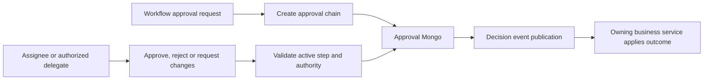

# Approval service

## Current design and detailed contract

[Complete REST endpoint reference](approval-service-endpoints.md) includes current request bindings, response DTOs and source links. See [platform end-to-end flows](END_TO_END_DESIGN.md) and [component purposes](SHARED_COMPONENTS.md). Older phase-specific verification notes below are historical; this documentation refresh does not claim new runtime acceptance.

## Business ownership

`approval-service` owns reusable approval requests, decision chains, delegations, SLA state and approval events. It references a job by ID and never owns job content.

## Business logic

- An approval needs at least one step.
- Steps in the lowest group become current; the same group runs in parallel.
- A later group starts only after every current-group step is complete.
- A concrete approver can act only on their assigned current step; `me` remains the local/demo placeholder.
- Reject and request-changes require a reason.
- Ad-hoc delegation preserves the original approver in audit data.
- Active scheduled delegation periods are resolved when new approval steps are created, preserving the original owner in audit data.
- Step SLA deadlines produce overdue projections and daily reminder events.
- The final job approval or negative decision calls `job-service` through a secret-protected port.
- State-change events are persisted in the approval outbox and relayed to `approval.events.v1`.

## REST endpoints

| Method | Endpoint | Purpose |
|---|---|---|
| `POST` | `/api/v1/approvals` | Create an approval chain |
| `POST` | `/api/v1/internal/approvals` | Create from another service using the internal secret |
| `GET` | `/api/v1/approvals` | List by UI scope, assignee or status |
| `GET` | `/api/v1/approvals/counts` | Count waiting, requested and completed items |
| `GET` | `/api/v1/approvals/sla-overdue` | List overdue approvals |
| `GET` | `/api/v1/approvals/{id}` | Read steps, diff, impact and terms |
| `POST` | `/api/v1/approvals/{id}/approve` | Approve the actor's current step |
| `POST` | `/api/v1/approvals/{id}/reject` | Reject with a required reason |
| `POST` | `/api/v1/approvals/{id}/request-changes` | Return the subject for changes |
| `POST` | `/api/v1/approvals/{id}/undo` | Reopen an approved or rejected request |
| `POST` | `/api/v1/approval-delegations` | Delegate a current step |
| `GET` | `/api/v1/approval-delegation-periods` | List actor delegation periods |
| `POST` | `/api/v1/approval-delegation-periods` | Create a scheduled delegation period |

## Design patterns

- Hexagonal architecture.
- Aggregate root and state machine.
- Chain of responsibility with parallel groups.
- Repository and adapter.
- Optimistic locking.
- Outbox relay.
- Scheduler for SLA reminders.
- RBAC plus assigned-resource authorization.

## Components

- Spring Web MVC, Validation, Security and OAuth2 Resource Server.
- Spring Data MongoDB.
- Spring Kafka and scheduled tasks.
- MongoDB database `oh_approval`.
- Kafka topic `approval.events.v1`.
- REST client ports for job callbacks.
- OpenAPI and AsyncAPI contracts in `contracts/`.

## Tests and acceptance

- Sequential and parallel chain tests.
- Assigned-actor, rejection-reason and undo tests.
- Tenant isolation test.
- Architecture boundary test.
- Included in the Phase 2 API and live browser workflows.
