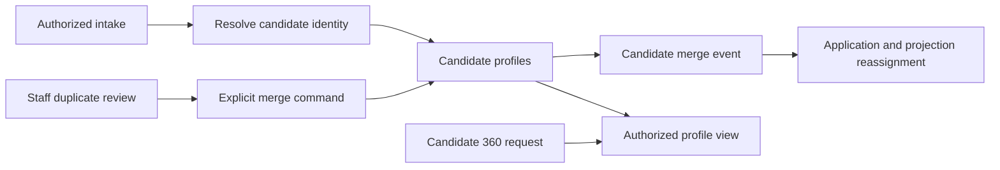

# Candidate service

## Current design and detailed contract

[Complete REST endpoint reference](candidate-service-endpoints.md) includes current request bindings, response DTOs and source links. See [platform end-to-end flows](END_TO_END_DESIGN.md) and [component purposes](SHARED_COMPONENTS.md). Older phase-specific verification notes below are historical; this documentation refresh does not claim new runtime acceptance.




Java 25 / Spring Boot 4.1.1, port 8085, MongoDB `oh_candidate`.

## Business logic and components

`CandidateController` enforces staff roles and token-derived tenants; internal operations require the
shared service secret. `CandidateService` resolves a normalized email within a tenant, records field
provenance, applies revision-checked application projections, proposes duplicates, and runs reviewed merges.
`ApplicationProjectionConsumer` consumes full-workflow application events and fetches a minimal projection
through a secret-authenticated internal endpoint. The application service also retries dirty projections,
so temporary Kafka/HTTP outages do not permanently lose the view.

Matching email resolves to one candidate within a tenant. Matching name or a nonempty matching phone
produces a suggestion, not an automatic merge. Suggestions are streamed from the tenant's records,
returning up to 100 unresolved pairs per request. These are deterministic matching rules, not an LLM or
a calibrated probabilistic identity model. Review all differences before confirming a merge.

The merge operation keeps candidate A as the survivor; the reviewer selects A/B for each differing field.
Both application, document and timeline maps are retained. B becomes an alias, so old IDs resolve to A.
Merge operations and candidate locks survive restarts. Concurrent runs claim the operation; terminal
operations have recoverable lock cleanup. `CandidateMerged` causes application-service to reassign
source candidate references. Replays and older projection revisions do not overwrite newer application states.

Collections: `candidates`, `merge_suggestions`, `merge_dismissals`, `candidate_merges`.
Components: Spring MVC/Security, MongoTemplate/indexes, Spring Kafka, Jackson 3, bounded internal HTTP
client, scheduled merge recovery, shared embedded outbox relay, Actuator.

## REST endpoints

All paths below start with `/api/v1`.

| Method | Path | Behaviour |
|---|---|---|
| GET | `/candidates?q=&after=&limit=25` | Tenant-only summaries; literal name/email search, keyset cursor, limit 1–100; excludes merged aliases and erased profiles |
| GET | `/candidates/{id}/360` | Canonical candidate, provenance, applications, documents, timeline and consent |
| PUT | `/candidates/{id}/owner` | Change owner; rejects concurrent merge |
| GET | `/merge-suggestions` | Up to 100 unresolved tenant-local suggestions |
| POST | `/merge-suggestions/{id}/dismiss` | Persist a reviewed non-match |
| POST | `/candidates/merge` | `{suggestionId, keep: {field: "a" or "b"}}`; returns DONE/PENDING/CONFLICT |
| POST | `/internal/candidates/resolve` | Resolve email; internal secret required |
| POST | `/internal/candidates/project` | Apply a monotonic application projection; internal secret required |
| GET | `/internal/candidates/{id}/canonical?tenantId=…` | Resolve aliases; internal secret required |

Internal endpoints are not routed by the gateway. All persistence lookups include tenant identity.
Merge has no user-facing undo operation. Raw resume text is not returned by Candidate 360.

## Candidate 360 directory navigation

The console sidebar opens `/candidates`, not the mock candidate `cand_0`. The directory
uses `GET /api/v1/candidates` and links to real returned IDs. Tenant identity comes from
the authenticated principal, never from a caller-supplied directory parameter. Summaries
exclude documents, phone numbers, provenance and other full-profile content. Empty tenants
show an Add candidates action; obsolete profile links offer Browse candidates.

Deploy the updated candidate-service (including service-support's tenant/ID index) and
refresh the updated console. For the local tenant portal stack:

```sh
./run-backend.sh deploy --tenant-portals --no-scan candidate-service --follow
```

`--no-scan` is only for trusted local test uploads. No Keycloak role or mapper change is
required for this navigation fix. The backend still enforces its existing staff access
and tenant boundary; other-tenant or nonexistent profile IDs continue to return 404.

## Patterns

- Specification-style deterministic identity rules and explicit human review.
- Resumable saga with ordered candidate locks and operation claims; no cross-database transaction.
- CQRS projection with per-application revision fence and durable retry fallback.
- Embedded outbox; at-least-once Kafka delivery on `candidate.events.v1`.
- Alias-based identity continuity and field-level provenance.

## Verification

Unit sources cover tenant-scoped reads and forbidden cross-tenant suggestions. The opt-in
`CandidateMongoAcceptanceTest` covers email resolution, stale projections, merge replay, history preservation
and terminal-lock recovery. It creates/drops only a uniquely named `oh_phase3_test_*` database.
These Java tests have **not been run by the assistant**.

```bash
OPENHIRE_RUN_MONGO_TESTS=true ./gradlew :candidate-service:test
```

Set `OPENHIRE_TEST_MONGO_URI` if the test server is not `mongodb://localhost:27017`.
