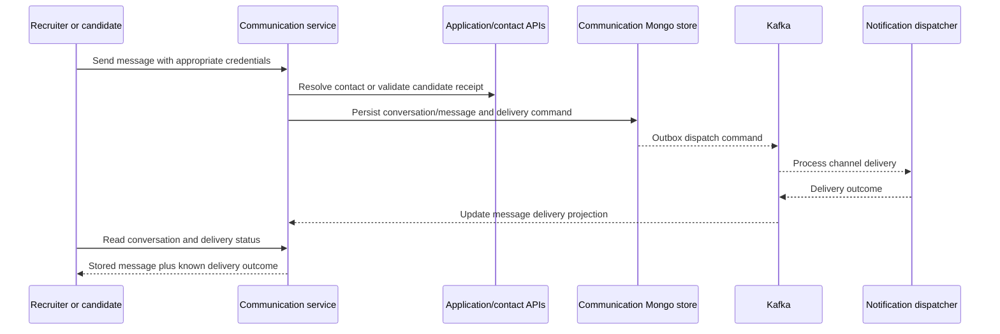

# Communication service

Owns conversations, message content, templates, staff notifications, candidate preferences and digests. It requests external delivery from notification-dispatcher; storing a message does not mean email/SMS/WhatsApp was delivered.

## End-to-end design

Lifecycle events also trigger notification rules. Staff preferences select enabled channels and digest behavior. Candidate preferences contain channel, quiet hours, timezone and marketing opt-out. AI drafting returns editable text; it is not an implicit send operation.

## REST groups and payloads

[Complete reference](communication-service-endpoints.md): **19 operations**, with exact headers, query defaults and DTO fields.

| Group | Main endpoints | Details |
| --- | --- | --- |
| Staff conversations | `GET/POST /api/v1/conversations`; `GET /conversations/{id}` | Start body `{applicationId}`; create returns 201 |
| Staff messages | `POST /api/v1/conversations/{id}/messages` | `{text,channel}`; EMAIL/SMS/WHATSAPP enum; returns 201 message view, not proof of delivery |
| Drafting | `POST /api/v1/conversations/{id}/ai-draft` | Returns `{text}`; user must separately send |
| Templates | `GET /api/v1/message-templates`; `PUT /{key}`; `POST /{key}/preview` | `{channels,subject,body}`; preview accepts sample variables |
| Staff notifications | `/api/v1/notifications`, `/unread-count`, `/{id}`, `/read-all` | List defaults `filter=all`, `limit=50`; PATCH accepts only `{read:true}` |
| Staff preferences | `GET/PUT /api/v1/me/notification-preferences` | `{matrix,quietHours,emailDigest}`; scoped to authenticated user |
| Candidate thread | `GET/POST /api/v1/public/applications/{applicationId}/messages` | Required tenantId query and `X-Application-Receipt`; reply `{text}` |
| Candidate preferences | `GET/PUT /api/v1/public/applications/{applicationId}/communication-preferences` | Same receipt; `{preferredChannel,quietHours,timezone,marketingOptOut}` |
| Internal template send | `POST /api/v1/internal/messages/template` | Internal service secret; `{tenantId,applicationId,templateKey,variables,actor}` |

Candidate receipt validation is a separate security boundary from staff realm roles. Internal template-send credentials must not be exposed to the browser. Invalid channel/preference enum strings are rejected rather than guessed.

## Components and purpose

| Component | Purpose |
| --- | --- |
| Conversation/template/notification/public/internal controllers | Keep staff, self-service and service-to-service entry points separate |
| `StaffViewers` | Resolve authorized staff and tenant identity |
| `CommunicationService`, domain `Message`/`Conversation` | Coordinate conversation and message lifecycle |
| `MessageTemplate`, `DefaultTemplates`, `TriggerRules` | Render approved content and map lifecycle triggers |
| Staff/candidate preference stores | Retain channel, quiet-hours, digest and opt-out policy |
| Mongo message/conversation/notification/digest stores | Persist message content, UI projections and delayed digests |
| Contact directory and reply drafter adapters | Validate contacts/receipts and obtain editable AI drafts |
| Lifecycle listener, delivery listener, digest scheduler | React to source events, reflect delivery outcomes and release digests |

Patterns: ports/adapters, template rendering, event-driven notification rules, outbox, idempotent lifecycle processing and separate delivery projection. Do not infer exactly-once external sending from a locally deduplicated message.

## Failure and operations

Inspect both message state and dispatcher delivery state when a message is queued but not received. Unconfigured external channels are not implemented providers; fallback/failure is handled by notification-dispatcher. Candidate marketing opt-out and quiet hours must be preserved across retries. Privacy adapters provide owner-service erasure integration; see [shared components](SHARED_COMPONENTS.md).

Source: [service](../../communication-service/src/main/java/com/openhire/communication), [configuration](../../communication-service/src/main/resources/application.yml), [tests](../../communication-service/src/test).
