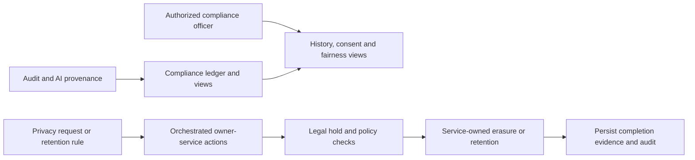

# compliance-service

## Current design and detailed contract

[Complete REST endpoint reference](compliance-service-endpoints.md) includes current request bindings, response DTOs and source links. See [platform end-to-end flows](END_TO_END_DESIGN.md) and [component purposes](SHARED_COMPONENTS.md). Older phase-specific verification notes below are historical; this documentation refresh does not claim new runtime acceptance.

## Business responsibilities

Maintain the tenant-scoped audit ledger and decision provenance, publish consent versions, coordinate candidate
exports and erasures, enforce legal holds, evaluate candidate retention, and produce aggregated fairness reports.
Candidate requests require an application receipt; staff access is role-checked and tenant-scoped.

Privacy completion requires acknowledgements from every configured participant. Acknowledgements must match the
candidate, request type and an in-progress request. Erasure accepts only ERASED, NOTHING_HELD or
RETAINED_LEGAL_BASIS (with an explanation); export requires EXPORTED and a section object. Invalid acknowledgements
leave the participant pending. Late events are suppressed by erasure tombstones.

## REST endpoints

All paths are prefixed by `/api/v1`. Exact methods, parameters, credentials and request bodies are in
[`phase7-api.openapi.json`](../../contracts/phase7-api.openapi.json).

| Methods | Path | Business logic |
|---|---|---|
| GET | `/audit-events`, `/audit-events/verify`, `/audit-events/export` | Filter, verify and export the append-only hash chain |
| GET | `/ai-decisions`, `/ai-decisions/{id}`, `/trace/applications/{applicationId}` | AI evidence and human decision trace |
| GET, POST | `/consent-texts` | Read versions and publish a new active version |
| GET | `/consent-records` | Candidate consent history |
| GET, POST | `/privacy/requests` | List or create export/erasure requests |
| GET | `/privacy/requests/{id}` | Progress, participant acknowledgements and completion evidence |
| GET, POST | `/legal-holds` | List or place a hold |
| POST | `/legal-holds/{id}/release` | Release a hold and resume eligible requests |
| GET | `/retention-policies` | Read policy settings |
| PUT | `/retention-policies/{key}` | Change a policy |
| POST | `/retention-policies/run` | Dry-run by default; live candidate erasure evaluation when requested |
| GET | `/reports/fairness`, `/compliance/overview` | Suppressed small-group fairness aggregates and governance overview |
| GET, POST | `/public/applications/{applicationId}/privacy-requests` | Receipt-protected candidate privacy requests |
| GET | `/public/privacy-requests/{id}/export` | Download a completed, unexpired candidate export |
| GET, PUT | `/public/applications/{applicationId}/self-identification` | Voluntary encrypted demographic data |
| GET | `/internal/consent/active` | Service-secret-protected active consent |

## Patterns and components

- Hexagonal architecture: controllers/listeners and Mongo/HTTP/Redis/crypto adapters surround application services.
- Append-only ledger: canonical JSON and SHA-256 chaining, with duplicate event handling.
- Process manager: `PrivacyService` coordinates multi-service acknowledgements rather than directly deleting other databases.
- Policy: `HoldPolicy` and `RetentionService` protect held, hired and active candidates.
- Event projections: `Projections` and `DecisionHistory` join audit, application and AI evidence.
- MongoDB stores requests, audit records, policies and projections; Kafka transports outbox events and privacy acknowledgements.
- Redis locks scheduled sweeps; AES-GCM protects self-identification; shared audit and privacy libraries provide cross-service conventions.

## Verification and boundaries

Unit, controller, architecture, crypto and isolated Mongo tests are under `src/test`.
Enable database checks with `OPENHIRE_RUN_MONGO_TESTS=true`.
The end-to-end gate is `backend/scripts/verify-phase7-workflow.mjs`, followed by the live Phase 7 browser test.
Record retention runs in the same daily sweep and manual endpoint. `recordPolicies` reports per-policy status,
bounded eligible counts and processed counts; failures and legal holds are visible rather than counted as success.
`audit.events` creates verified `audit_archive` copies without changing the source chain.
`ai.request-logs` calls the AI gateway's protected owner-side purge, preserving pending outbox events. Because
request logs lack candidate IDs, any active tenant legal hold conservatively blocks this purge.
See [low-memory operations](../PHASE_7_OPERATIONS.md) and [phase evidence](../PHASE_7.md).
