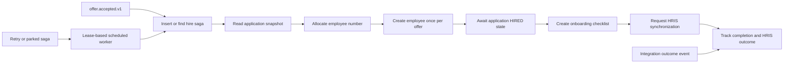

# Employee service

Owns employee creation after accepted offers, employee numbers, onboarding checklists, referral rewards and durable hire-saga progress. HRIS success is a separately reported integration outcome, not inferred from an accepted offer.

## End-to-end design

## Business rules and recovery

`HireSagaService.start` is idempotent by offer. A worker claims due sagas with a lease and persists their step after execution. Steps are `SNAPSHOT`, `CREATE_EMPLOYEE`, `UPDATE_APPLICATIONS`, `ONBOARDING`, `HRIS_SYNC`, and `COMPLETE`. `UPDATE_APPLICATIONS` waits for a HIRED application event and also polls the application API to cover missed events; it is not an arbitrary direct database write.

The employee number is persisted in the saga before employee creation is retried. Employee lookup by offer and duplicate-key handling prevent a replay from creating a second employee. Referral-sourced hires create a pending reward once. Onboarding uses a standard checklist. Staff or the owning employee can update permitted tasks; personal onboarding is resolved from the authenticated email, not a client-selected employee ID.

The worker bounds steps per claim and records retry/backoff state. Operator retry is audited. HRIS outcomes are consumed from `integration.events.v1`; the current integration hub does not yet supply a selected production HRIS adapter. Therefore pending/retrying HRIS state must not be labelled as a successful external sync.

## REST contract

[Complete reference](employee-service-endpoints.md): **10 operations**.

| Method/path | Access and input | Output / effect |
| --- | --- | --- |
| `GET /api/v1/employees` | Staff; optional `status`, `joiningFrom` | Employee summary page |
| `GET /api/v1/employees/{id}` | Staff, tenant-owned ID | Employee detail |
| `POST /api/v1/employees/{id}/activate` | Staff; domain activation checks | Updated detail |
| `GET /api/v1/employees/{id}/onboarding` | Viewer ownership/role checks | Onboarding view |
| `PATCH /api/v1/employees/{id}/onboarding/tasks/{taskId}` | `{done: boolean}`; task-level authorization | 204 |
| `GET /api/v1/me/onboarding` | Authenticated employee email | Personal onboarding view |
| `PATCH /api/v1/me/onboarding/tasks/{taskId}` | `{done: boolean}` | 204; own checklist |
| `GET /api/v1/hire-sagas` | Operator; optional `status` | Saga progress page |
| `POST /api/v1/hire-sagas/{id}/retry` | Operator | 204; restart eligible retry workflow |
| `GET /api/v1/me/referral-rewards` | Authenticated subject | That referrer's reward page |

`done` is required; a missing Boolean is not treated as false. Full response record fields are in the reference.

## Components and patterns

| Component | Purpose |
| --- | --- |
| `EmployeeController`, `Viewers` | Staff, employee-self and operator API boundaries |
| `EmployeeApplicationService` | Employee reads, activation, task updates and reward views |
| `HireSagaService` / `HireSaga` | Durable orchestration, persisted steps, retries and external outcomes |
| `EmployeeNumberAllocator` | Allocate stable organization employee identifiers |
| `OnboardingTemplate` | Build standard onboarding tasks |
| Saga/employee/reward Mongo repositories | Own durable state; uniqueness and optimistic saves |
| Application HTTP adapter | Fetch authoritative application snapshots/stage |
| Kafka listeners and scheduler | Consume accepted offers/stage changes/HRIS results; advance due work |

Patterns: orchestration saga, idempotent consumer, lease-based worker, repository ports, optimistic retry and outbox. There is no distributed two-phase commit and no claim of exactly-once network effects.

Source: [service](../../employee-service/src/main/java/com/openhire/employee), [configuration](../../employee-service/src/main/resources/application.yml), [tests](../../employee-service/src/test). Review application availability and saga state before manual retries; do not delete saga records to retry a hire.
