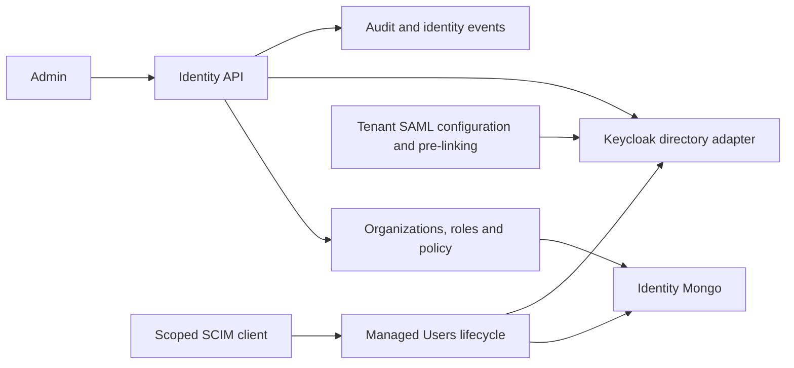

# Identity service

## Current design and detailed contract

[Complete REST endpoint reference](identity-service-endpoints.md) includes current request bindings, response DTOs and source links. See [platform end-to-end flows](END_TO_END_DESIGN.md) and [component purposes](SHARED_COMPONENTS.md). Older phase-specific verification notes below are historical; this documentation refresh does not claim new runtime acceptance.



Enterprise additions: `SamlController`, `ScimController`, `ScimUsers` and `KeycloakEnterpriseDirectory` implement tenant-scoped SAML configuration/pre-linking and a constrained SCIM Users profile. Local mode cannot fake successful enterprise provisioning. See [enterprise business rules, endpoint details, setup and limitations](../PHASE_8_ENTERPRISE_RECOVERY.md). Stored SSO policy alone is not proof of a connected provider; Groups and automatic seat enforcement are not implied.


## Purpose

The identity service owns OpenHire organizations, tenant security configuration, team members, roles, invitations, API credentials, setup progress, platform quotas, and break-glass access requests. It enforces tenant boundaries before data reaches MongoDB and isolates the rest of the platform from Keycloak-specific APIs.

The service is implemented with Java 25 and Spring Boot 4.1.1. It listens on port `8081` by default and owns the `openhire_identity` MongoDB database.

## Service boundary

The identity service is responsible for:

- Creating, listing, activating, and suspending organizations.
- Creating the default organization roles and permissions.
- Listing team members, changing their roles, and disabling access.
- Creating, inspecting, resending, and accepting team invitations.
- Creating, rotating, revoking, and validating API keys.
- Maintaining authentication policy, SSO settings, organization quotas, and setup progress.
- Recording time-limited break-glass requests for platform support.
- Provisioning users and role mappings in Keycloak through an adapter.
- Publishing versioned identity and tenancy events.

The identity service does not own browser sessions, OAuth redirects, rate limiting, jobs, candidates, or application workflow data.

## Architecture and project layers

```text
com.openhire.identity
├── domain
│   ├── IdentityModels
│   └── IdentityPolicy
├── application
│   ├── IdentityApplicationService
│   └── port
│       ├── IdentityRepositories
│       ├── IdentityProvider
│       └── IdentityEventPublisher
├── adapter
│   ├── in.web
│   │   └── IdentityController
│   └── out
│       ├── mongo
│       │   └── MongoIdentityRepository
│       ├── idp
│       │   ├── KeycloakIdentityProvider
│       │   └── LocalIdentityProvider
│       └── events
│           └── IdentityEventConfiguration
└── config
    ├── IdentityConfiguration
    ├── MongoIndexConfiguration
    └── SecurityConfiguration
```

Dependency direction is inward. The domain contains business state and policies. The application layer coordinates use cases through ports. HTTP, MongoDB, Kafka, and Keycloak remain replaceable adapters.

## Business logic

### Organization creation

1. Validate and normalize the requested organization slug.
2. Reject the request when the slug is already in use.
3. Create an active organization with a generated identifier and UTC timestamp.
4. Provision the organization through the configured identity-provider adapter.
5. Persist the organization in MongoDB.
6. Seed `ORG_ADMIN`, `RECRUITER`, `HIRING_MANAGER`, and `INTERVIEWER` roles.
7. Mark the organization setup step as complete.
8. Store default authentication, SSO, and quota settings.
9. Publish `identity.org.created.v1`.

Default security settings are:

- MFA is optional.
- Five failed attempts are allowed before lockout.
- Lockout lasts 15 minutes.
- SSO is disabled and prepared for OIDC.
- Maximum users: 100.
- Maximum API keys: 20.
- Maximum active jobs: 100.

### Organization status

Only a super administrator can change an organization status. An organization can be `ACTIVE` or `SUSPENDED`. Suspended organizations cannot issue new invitations or API keys. Each status change publishes `identity.org.status-changed.v1`.

### Team members and roles

- Member lookups include `organizationId`, preventing cross-tenant reads.
- An organization administrator can change member roles or disable a member.
- Requested role names must already exist in the same organization.
- Role changes are sent to the identity provider before the local member record is updated.
- Disabling a member disables the identity-provider account and updates the local status to `DISABLED`.
- Recruiters may list users but cannot change roles or disable members.

### Invitations

Invitation creation enforces these rules:

1. The organization must exist and be active.
2. Every requested role must exist in the organization.
3. The email address is normalized to lowercase and validated.
4. The email cannot already belong to an organization member.
5. A cryptographically random 32-byte token is generated.
6. Only the SHA-256 token hash is stored.
7. The plaintext token is returned once to the caller.
8. The invitation expires after seven days.

Invitation acceptance hashes the presented token, loads the matching pending invitation, checks its expiry, provisions the user in the identity provider, creates an active member, marks the invitation accepted, and publishes `identity.user.invite-accepted.v1`.

Successful acceptance returns `verified: true` and `redirectTo: /recruiter/today` so the frontend can navigate immediately.

### Verification completion

Keycloak owns verification-code validation. After verification succeeds, the public completion endpoint returns:

```json
{
  "verified": true,
  "redirectTo": "/recruiter/today",
  "member": null
}
```

The frontend or BFF must use `redirectTo` immediately rather than leaving the user on the verified-code screen.

### API keys

API-key creation uses a one-time secret pattern:

1. Generate a random display prefix beginning with `oh_`.
2. Generate an independent 32-byte secret.
3. Persist only the SHA-256 secret hash, prefix, scopes, status, and audit timestamps.
4. Return `prefix.secret` once.

Validation splits the presented credential into prefix and secret, locates the active key by prefix, compares hashes with `MessageDigest.isEqual`, updates `lastUsedAt`, and returns the owning organization and scopes.

Rotation revokes the current key before issuing a new key with the same name and scopes. Revocation changes status to `REVOKED`. The identity service never returns persisted secret hashes through its public DTOs.

### Authentication policy and SSO

Each organization has one `TenantSecuritySettings` record containing:

- MFA requirement.
- Failed-attempt and lockout settings.
- Allowed email domains.
- SSO protocol, issuer, client identifier, enabled state, and SCIM state.
- User, API-key, and active-job quotas.

Authentication policy rejects values below the security minimum of three failed attempts and one lockout minute. Settings are tenant-keyed upserts, so repeated updates do not create duplicate records.

### Setup progress

Setup progress stores a unique set of completed step names for an organization. Completing a step is idempotent because duplicate step names are removed by the set.

### Break-glass requests

A super administrator can request temporary platform intervention for an organization. A new request:

- Is created in `PENDING` status.
- Records requester, reason, organization, and audit trail.
- Expires 30 minutes after creation.
- Publishes `identity.tenant.break-glass-requested.v1`.

Creating the request does not itself grant candidate-data access.

## REST endpoint list

All tenant-scoped endpoints require `X-Tenant-Id` after the gateway resolves the tenant. Production authorization uses Keycloak roles through Spring method security.

### Platform administration

| Method | Endpoint | Authorization | Business operation |
|---|---|---|---|
| `POST` | `/api/v1/platform/organizations` | `SUPER_ADMIN` | Create an organization, seed roles and default settings, and publish an event |
| `GET` | `/api/v1/platform/organizations` | `SUPER_ADMIN` | List all organizations |
| `PATCH` | `/api/v1/platform/organizations/{id}/status` | `SUPER_ADMIN` | Activate or suspend an organization |
| `GET` | `/api/v1/platform/organizations/{id}/quota` | `SUPER_ADMIN` | Read organization quotas |
| `PUT` | `/api/v1/platform/organizations/{id}/quota` | `SUPER_ADMIN` | Replace organization quotas |
| `POST` | `/api/v1/platform/organizations/{id}/break-glass` | `SUPER_ADMIN` | Create a 30-minute break-glass request |
| `GET` | `/api/v1/platform/organizations/{id}/break-glass` | `SUPER_ADMIN` | List break-glass requests for an organization |

### Team members and roles

| Method | Endpoint | Authorization | Business operation |
|---|---|---|---|
| `GET` | `/api/v1/users` | `ORG_ADMIN` or `RECRUITER` | List members for the resolved tenant |
| `PATCH` | `/api/v1/users/{id}/roles` | `ORG_ADMIN` | Validate and replace member roles |
| `DELETE` | `/api/v1/users/{id}` | `ORG_ADMIN` | Disable the member locally and in the identity provider |
| `GET` | `/api/v1/roles` | `ORG_ADMIN` | List tenant roles |
| `POST` | `/api/v1/roles` | `ORG_ADMIN` | Create a custom role |
| `PUT` | `/api/v1/roles/{id}/permissions` | `ORG_ADMIN` | Replace role permissions |

### Invitations and verification

| Method | Endpoint | Authorization | Business operation |
|---|---|---|---|
| `POST` | `/api/v1/invites` | `ORG_ADMIN` | Issue a seven-day invitation and return its token once |
| `GET` | `/api/v1/invites` | `ORG_ADMIN` | List tenant invitations without token hashes |
| `POST` | `/api/v1/invites/{id}/resend` | `ORG_ADMIN` | Issue a new token for the invitation email and roles |
| `GET` | `/api/v1/public/invitations/{token}` | Public | Validate an invitation and show organization, email, roles, and expiry |
| `POST` | `/api/v1/public/invitations/{token}/accept` | Public | Provision the member, accept the invitation, and return the recruiter redirect |
| `POST` | `/api/v1/public/verifications/{code}/complete` | Public | Return verified state and automatic recruiter redirect after provider verification |

### API keys

| Method | Endpoint | Authorization | Business operation |
|---|---|---|---|
| `GET` | `/api/v1/api-keys` | `ORG_ADMIN` | List API-key metadata without secret hashes |
| `POST` | `/api/v1/api-keys` | `ORG_ADMIN` | Issue a new API key and return its plaintext secret once |
| `POST` | `/api/v1/api-keys/{id}/rotate` | `ORG_ADMIN` | Revoke the old key and issue a replacement |
| `DELETE` | `/api/v1/api-keys/{id}` | `ORG_ADMIN` | Revoke an API key |
| `POST` | `/api/v1/internal/api-keys/validate` | Internal shared credential | Validate a gateway-presented API key and return tenant and scopes |

### Tenant configuration

| Method | Endpoint | Authorization | Business operation |
|---|---|---|---|
| `GET` | `/api/v1/setup` | `ORG_ADMIN` | Read organization setup progress |
| `PATCH` | `/api/v1/setup/{step}/complete` | `ORG_ADMIN` | Mark one setup step complete |
| `GET` | `/api/v1/auth-policy` | `ORG_ADMIN` | Read the authentication policy |
| `PUT` | `/api/v1/auth-policy` | `ORG_ADMIN` | Validate and replace the authentication policy |
| `GET` | `/api/v1/sso-config` | `ORG_ADMIN` | Read SSO configuration |
| `PUT` | `/api/v1/sso-config` | `ORG_ADMIN` | Replace SSO configuration |

## Design patterns

| Pattern | Usage |
|---|---|
| Hexagonal architecture | Keeps domain and application logic independent from HTTP, MongoDB, Kafka, Redis, and Keycloak |
| Ports and adapters | Repository, identity-provider, and event-publisher interfaces define outbound dependencies |
| Application service | `IdentityApplicationService` coordinates complete business use cases |
| Repository | `MongoIdentityRepository` implements persistence ports and tenant-scoped queries |
| Policy and specification | `IdentityPolicy` normalizes email, validates slugs, and checks invitation eligibility |
| Anti-corruption layer | `KeycloakIdentityProvider` converts OpenHire operations into Keycloak Admin REST calls |
| Strategy | Configuration selects either `LocalIdentityProvider` or `KeycloakIdentityProvider` |
| Role-based access control | `@PreAuthorize` expressions enforce platform and tenant administration permissions |
| One-time secret | Invitation and API-key plaintext values are returned once and never persisted |
| Domain event | Successful state changes publish versioned identity events |
| Idempotent upsert | Setup and tenant settings use organization-keyed MongoDB upserts |
| Constant-time comparison | Internal credentials and API-key hashes use `MessageDigest.isEqual` |

## Components used

### Application components

| Component | Responsibility |
|---|---|
| `IdentityController` | HTTP request validation, authorization annotations, DTO mapping, and response status |
| `IdentityApplicationService` | Business workflow orchestration and event publication |
| `IdentityModels` | Immutable domain records and lifecycle enums |
| `IdentityPolicy` | Pure validation and invitation rules |
| `IdentityRepositories` | Persistence port definitions for each aggregate |
| `IdentityProvider` | Identity-provider abstraction |
| `IdentityEventPublisher` | Event-publication abstraction |

### Adapter and infrastructure components

| Component | Technology | Responsibility |
|---|---|---|
| `MongoIdentityRepository` | Spring Data MongoDB and `MongoTemplate` | Persists tenant-owned aggregates and applies tenant criteria |
| `MongoIndexConfiguration` | MongoDB indexes | Enforces unique slug, member email, invitation hash, API-key prefix, setup, and settings keys |
| `KeycloakIdentityProvider` | Spring `RestClient` and Keycloak Admin REST | Provisions users, assigns realm roles, and disables accounts |
| `LocalIdentityProvider` | Local adapter | Allows development without a running Keycloak instance |
| `IdentityEventConfiguration` | Spring Kafka or structured logging | Selects Kafka publishing or local logging through configuration |
| `SecurityConfiguration` | Spring Security resource server and method security | Provides local and OIDC security modes |
| `TenantContextFilter` | Shared platform starter | Resolves `X-Tenant-Id` and rejects missing tenant context |
| `GlobalExceptionHandler` | Shared platform starter | Returns RFC 9457 problem responses |
| `DomainEventEnvelope` | Shared platform starter | Standardizes event identifiers, version, tenant, aggregate, correlation, and payload |

### Runtime dependencies

| Dependency | Purpose |
|---|---|
| MongoDB | System of record for organizations, members, roles, invitations, API keys, settings, setup, and break glass |
| Keycloak | Staff and candidate authentication, verification, TOTP, password reset, and role mappings |
| Kafka | Identity integration-event transport when enabled |
| API gateway | Browser session boundary, API-key validation caller, and tenant-header producer |

## MongoDB collections

| Collection | Owned data | Important index |
|---|---|---|
| `organizations` | Organization profile and status | Unique `slug` |
| `users` | Tenant members and assigned roles | Unique `organizationId + email` |
| `roles` | System and custom roles | Queried by `organizationId` |
| `invites` | Invitation state and token hash | Unique `tokenHash` |
| `api_keys` | API-key hash, prefix, scopes, status, and audit time | Unique `prefix` |
| `setup_progress` | Completed setup steps | Unique `organizationId` |
| `tenant_security_settings` | Authentication policy, SSO, and quotas | Unique `organizationId` |
| `break_glass_requests` | Time-limited platform access requests | Queried by `organizationId` |

## Published events

| Event | Trigger |
|---|---|
| `identity.org.created.v1` | Organization creation completes |
| `identity.org.status-changed.v1` | Organization status changes |
| `identity.user.roles-changed.v1` | Member roles change |
| `identity.user.disabled.v1` | Member is disabled |
| `identity.user.invited.v1` | Invitation is issued |
| `identity.user.invite-accepted.v1` | Invitation is accepted |
| `identity.tenant.role-created.v1` | Custom role is created |
| `identity.tenant.permissions-changed.v1` | Role permissions change |
| `identity.tenant.api-key-created.v1` | API key is issued |
| `identity.tenant.api-key-revoked.v1` | API key is revoked |
| `identity.tenant.auth-policy-changed.v1` | Authentication policy changes |
| `identity.tenant.sso-changed.v1` | SSO settings change |
| `identity.tenant.quota-changed.v1` | Organization quota changes |
| `identity.tenant.break-glass-requested.v1` | Break-glass request is created |

## Configuration

| Variable | Default | Purpose |
|---|---|---|
| `IDENTITY_PORT` | `8081` | HTTP port |
| `MONGODB_URI` | `mongodb://localhost:27017/openhire_identity` | MongoDB connection |
| `REDIS_HOST` | `localhost` | Redis host reserved for identity coordination |
| `REDIS_PORT` | `6379` | Redis port |
| `KAFKA_BOOTSTRAP_SERVERS` | `localhost:9092` | Kafka brokers |
| `SECURITY_MODE` | `local` | Selects local or OIDC resource-server security |
| `IDENTITY_PROVIDER` | `local` | Selects local or Keycloak identity adapter |
| `EVENT_PUBLISHER` | `log` | Selects logging or Kafka event publication |
| `OIDC_ISSUER_URI` | Staff realm URL | JWT issuer used in OIDC mode |
| `KEYCLOAK_BASE_URL` | `http://localhost:8180` | Keycloak base URL |
| `KEYCLOAK_REALM` | `openhire-staff` | Staff realm |
| `KEYCLOAK_ADMIN_CLIENT_ID` | `openhire-service` | Keycloak service client |
| `KEYCLOAK_ADMIN_CLIENT_SECRET` | `change-me` | Keycloak service credential; replace outside local development |
| `INTERNAL_SERVICE_SECRET` | Local development value | Protects internal API-key validation |

## Verification status

- Java 25 clean build succeeds.
- Domain-policy and MVC acceptance tests pass.
- Missing tenant headers are rejected for tenant-scoped endpoints.
- MongoDB organization creation, role seeding, invitations, and API keys were smoke tested.
- Valid API keys return `200` through the gateway; invalid keys return `401`.
- Verification completion returns the recruiter redirect.
- Keycloak and Kafka end-to-end acceptance still require those local services to be running.
