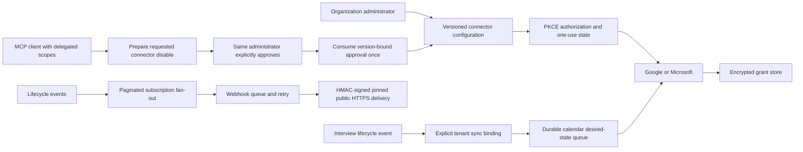

# Integration hub

Owns connector/webhook configuration, Google Calendar and Microsoft 365 calendar access, encrypted provider grants, calendar reconciliation, signed webhook delivery and scoped MCP tools. It is not a generic unrestricted HTTP proxy. Additional e-sign, HRIS and job-board providers are not selected/implemented.

## End-to-end design

## Business boundaries

Configuration saves are not proof of OAuth connectivity. Secrets use tenant-scoped `secret://<tenant>/...` references and mounted secret resolution; API views do not return the references or raw tokens. PKCE state is tenant/admin/version-bound, expires and is atomically consumed. AES-GCM encryption binds grant ciphertext to its owning tenant/connector. Disconnect removes local grants and invalidates stale writes; provider consent revocation is not implied.

Calendar changes use optimistic versions and an idempotency key, with durable desired-state reconciliation and stable provider creation identities. A PUT returns queued state, not provider success. New desired state cannot overwrite an in-flight receipt. Worker enablement is an operator setting. Interview synchronization is opt-in per tenant, filters events predating activation and rejects unsafe connector replacement. Candidate invitations and meeting-URL write-back remain incomplete.

Webhook fan-out walks all configuration pages. Delivery sends identifier-only payloads, HMAC signatures and fresh timestamps. DNS/address validation, connection pinning, TLS hostname verification and redirect refusal constrain outbound access. Delivery is at-least-once, with a 24-hour retry window and audited replay of terminal failures. Recipients must check signatures/time windows and deduplicate delivery IDs.

MCP exposes scoped connector listing and an explicitly approved connector-disable operation. It does not grant an autonomous tool arbitrary external write permission. Approval binds the same tenant/admin/connector/version and is single-use. The browser's approval credential is separate from the MCP client credential.

## REST endpoints and data

[Complete reference](integration-hub-endpoints.md): **23 operations**, including OAuth, calendar work, sync binding, webhook status and JSON-RPC entry points.

| Group | Paths | Key contract |
| --- | --- | --- |
| Configuration | `/api/v1/connectors`, `/connectors/{id}`, `/connectors/catalog`; equivalent webhook CRUD | `name`, `secretRef`, `enabled`, provider or endpoint/events; update version required; cursor `after`, limit 1–200 |
| OAuth | `POST /connectors/{id}/authorize`, `POST /connectors/oauth/callback` | PKCE state and `{state,code}` exchange; secrets never returned |
| Connection | `GET/DELETE /connectors/{id}/connection`; `GET /connectors/{id}/calendar/events` | Local grant status/disconnect and provider access check |
| Calendar work | `PUT/GET /connectors/{id}/calendar/work/{resource}` | `Idempotency-Key`; `{version,event,cancel}`; queued status (PUT 202) |
| Interview binding | `GET/PUT /connectors/interview-sync` | `{connectorId,enabled}`; explicit opt-in |
| Webhook delivery | `GET /webhooks/delivery-status`, `GET /webhooks/{id}/deliveries`, `POST /webhooks/{id}/deliveries/{delivery}/replay` | Operator flag, safe history and terminal-failure replay |
| MCP | `POST /api/v1/mcp` | JSON-RPC initialize/ping/tools; audience and read/write scope checks |
| Human approval | `GET /connectors/mcp-confirmations`; `POST /connectors/mcp-confirmations/{id}/decision` | Browser-admin `{approve:boolean}`; no implicit approval |

Paths abbreviated in this table inherit `/api/v1`. Public resource metadata is served internally at `/api/v1/public/mcp/resource-metadata` and externally through the gateway's well-known discovery route. Calendar event JSON fields are `title`, `start`, `end`, `timezone`, `attendees`, `onlineMeeting` (note lowercase `timezone`).

## Components and purpose

| Component | Purpose |
| --- | --- |
| `IntegrationService`, `IntegrationConfig`, Mongo config store | Validate configuration, tenant ownership and optimistic updates |
| `CalendarConnections`, `CalendarPorts`, `CalendarHttpProvider` | OAuth, refresh, reads and provider-specific writes |
| `FileIntegrationSecrets`, `TokenCipher`, grant store | Mounted-secret containment and encrypted token persistence |
| `CalendarWorkQueue`, `InterviewCalendarSync` | Reconcile durable calendar state and consume allowed interview events |
| `WebhookDeliveryQueue`, `PinnedWebhookSender`, `WebhookSecurity` | Signed, bounded, SSRF-constrained delivery/replay |
| `McpAccess`, `McpController`, `McpConfirmations` | Delegated scope enforcement, tool dispatch and human approval |
| `IntegrationBudget`, quota interceptor | Atomic cross-instance tenant request/admission budgets |

Patterns: ports/adapters, provider strategy, optimistic concurrency, encrypted credential boundary, capability state, outbox/event consumption, idempotency receipts, lease-based workers, human-in-the-loop authorization and atomic quota admission.

## Operations and verification boundaries

The detailed [Phase 8 guide](../PHASE_8.md) and [enterprise/recovery guide](../PHASE_8_ENTERPRISE_RECOVERY.md) define flags, signing format, budgets, tests and unfinished acceptance. Rate/admission quotas are not lifetime storage or user-seat caps. Mongo recovery tooling does not restore Keycloak/Kafka/object storage as a single platform snapshot. Live OAuth/provider interoperability is separate from passing contract tests.

Source: [service](../../integration-hub/src/main/java/com/openhire/integration), [configuration](../../integration-hub/src/main/resources/application.yml), [tests](../../integration-hub/src/test).
