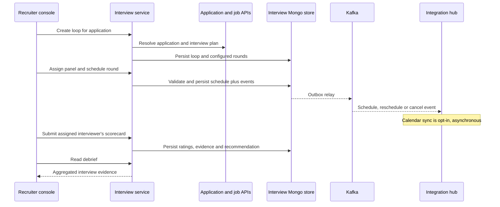

# Interview service

Owns interview loops, rounds, panel assignments, scheduling links, scorecards and debriefs. It does not make the hiring decision or own application stages. Source checkpoint: 2026-10-16; documentation of implemented code, not deployment certification.

## End-to-end design



## Business flow and rules

1. A coordinator creates/reads the application loop and configures the panel. Application/job data is read through service boundaries, not by accessing their databases.
2. Scheduling accepts an offset-bearing timestamp, IANA timezone, panel list and optional meeting URL. Invalid dates are rejected rather than interpreted in the server's timezone.
3. The round lifecycle exposes schedule, reschedule, cancel, no-show and complete commands. Domain rules determine which transitions are allowed; these are not arbitrary status setters.
4. A signed scheduling credential lets a candidate view slots, book, request alternatives or cancel. The credential is carried in `X-Scheduling-Token`, not a server-visible URL path.
5. Participant authorization controls personal interviews and scorecards. Coordinator access is distinct from assigned-panel access; a tenant claim alone is insufficient.
6. Submitted scorecards and the debrief provide evidence for a human decision elsewhere. Calendar write-back/candidate invite limitations are documented in the integration guide.

## REST endpoints and payloads

[Complete endpoint reference](interview-service-endpoints.md) includes **20 operations**, full paths, headers/query defaults, request DTOs and response records.

| Operation family | Main paths | Input / result |
| --- | --- | --- |
| Loop | `POST/GET /api/v1/applications/{applicationId}/interview-loop` | Create returns 201 `LoopView`; reads return the existing loop |
| Schedule views | `GET /api/v1/interviews`, `/interviews/unscheduled`, `/me/interviews` | Optional `week` date; filtered schedule/round pages |
| Round commands | `/api/v1/rounds/{roundId}/schedule`, `/panel`, `/reschedule`, `/cancel`, `/no-show`, `/complete` | See individual POST/PUT mappings and transition guards in reference |
| Candidate link | `POST /api/v1/rounds/{roundId}/scheduling-link` | Signed scheduling link view |
| Scorecards/debrief | `/api/v1/rounds/{roundId}/scorecard`, `/scorecards`; `/applications/{applicationId}/debrief` | Ratings, evidence, recommendation and aggregate debrief |
| Public scheduling | `/api/v1/public/scheduling` and command suffixes | `X-Scheduling-Token`; public does not mean uncredentialed |

Example schedule body (illustrative identifiers, not an instruction to send it):

```json
{"start":"2026-11-02T10:00:00+05:30","timezone":"Asia/Kolkata","panel":[{"name":"Panel member","email":"panel@example.com","role":"INTERVIEWER"}],"meetingUrl":"https://meet.example.com/interview"}
```

Scorecard input is `{ratings:[{competencyId,rating}], evidence, recommendation}`. Rating/recommendation strings must match the enums in the linked DTO/domain sources. Do not assume free-form numeric ratings.

## Components and purpose

| Component | Purpose |
| --- | --- |
| `InterviewController`, `PublicSchedulingController` | Separate staff coordination from token-authorized candidate actions |
| `Viewers` | Resolve tenant and coordinator/participant identity |
| `InterviewApplicationService` | Orchestrate loop, schedule, scorecard and public-link use cases |
| Interview domain + `DebriefBuilder` | Enforce transitions and construct evidence summaries |
| Mongo adapters / `interview_loops` | Durable loop state and service-owned event records |
| Application event listener | React to application lifecycle changes |
| Shared outbox/Kafka | Publish committed interview changes for communication and integration consumers |

Patterns: ports/adapters, aggregate state machine, capability token, optimistic persistence, outbox and asynchronous integration. These patterns do not make a remote calendar write synchronous or exactly-once.

## Failure, operations and tests

Malformed dates/body values are validation failures; missing or inaccessible records must not leak another tenant's information. A committed round update and a downstream calendar result are separate outcomes. Inspect failed events/queue state before retrying integrations. See [configuration](../../interview-service/src/main/resources/application.yml), [implementation](../../interview-service/src/main/java/com/openhire/interview), and [tests](../../interview-service/src/test). No runtime tests were rerun for this documentation-only update.
