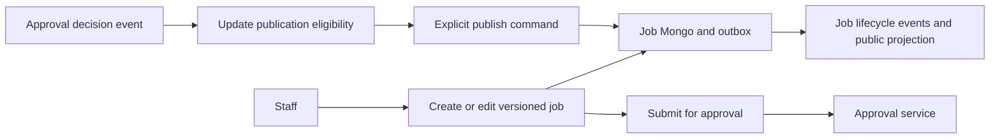

# Job service

## Current design and detailed contract

[Complete REST endpoint reference](job-service-endpoints.md) includes current request bindings, response DTOs and source links. See [platform end-to-end flows](END_TO_END_DESIGN.md) and [component purposes](SHARED_COMPONENTS.md). Older phase-specific verification notes below are historical; this documentation refresh does not claim new runtime acceptance.

## Business ownership

`job-service` owns job requisitions, immutable job versions, hiring teams, interview plans, hiring-stage configuration, pipeline templates and public/internal job projections.

## Business logic

- Every request is tenant scoped.
- Create commands accept a 24-hour Redis idempotency key.
- A content edit creates a new immutable version; approved history is never overwritten.
- Only drafts can be edited or submitted.
- Approval marks the current version as publishable without changing its content.
- Only the approved current version can be published.
- Open jobs can be paused or closed; paused and closed jobs can be reopened.
- `If-Match` rejects stale content and hiring-team updates.
- Job submission creates an approval request; approval decisions return through a secret-protected internal endpoint.
- Domain events are written to the job outbox and relayed to `job.events.v1`.
- The local LLM is isolated behind `JobDescriptionGenerator`.

## REST endpoints

| Method | Endpoint | Purpose |
|---|---|---|
| `GET` | `/api/v1/jobs` | List tenant jobs, optionally by status |
| `POST` | `/api/v1/jobs` | Create a draft or create-and-submit idempotently |
| `GET` | `/api/v1/jobs/{id}` | Read job detail and current immutable version |
| `PATCH` | `/api/v1/jobs/{id}` | Create a new job version; requires `If-Match` |
| `PUT` | `/api/v1/jobs/{id}/hiring-team` | Replace hiring team; requires `If-Match` |
| `PUT` | `/api/v1/jobs/{id}/versions/{version}/interview-plan` | Create a version with the updated interview plan |
| `POST` | `/api/v1/jobs/{id}/submit` | Submit the current draft for approval |
| `POST` | `/api/v1/jobs/{id}/publish` | Publish the approved current version |
| `POST` | `/api/v1/jobs/{id}/pause` | Pause an open job |
| `POST` | `/api/v1/jobs/{id}/close` | Close an open or paused job |
| `POST` | `/api/v1/jobs/{id}/reopen` | Reopen a paused or closed job |
| `POST` | `/api/v1/jobs/ai-draft` | Draft a description before job creation |
| `POST` | `/api/v1/jobs/{id}/versions/{version}/ai-draft` | Draft from stored version data |
| `POST` | `/api/v1/jobs/internal/{id}/approval-decision` | Apply approval-service callback |
| `GET` | `/api/v1/public/jobs?tenantId=...` | Public open-job projection |
| `GET` | `/api/v1/internal-jobs` | Employee open-job projection |
| `GET` | `/api/v1/me/inbox` | Recruiter Today projection |
| `GET/PUT` | `/api/v1/hiring-stages` | Read or save tenant hiring stages |
| `GET/PUT` | `/api/v1/pipeline-templates` | Read or save pipeline templates |
| `GET` | `/api/v1/pipeline-templates/resolve?key=...` | Resolve one pipeline template |

## Design patterns

- Hexagonal architecture.
- Aggregate root and explicit state machine.
- Immutable version object.
- Repository and adapter.
- Optimistic concurrency.
- Transactional-outbox structure.
- Idempotent command handling.
- Strategy/anti-corruption adapter for the LLM.
- RBAC through Keycloak realm-role conversion and method security.

## Components

- Spring Web MVC, Validation, Security and OAuth2 Resource Server.
- Spring Data MongoDB and Redis.
- Spring Kafka.
- MongoDB databases `oh_job` and outbox collections.
- Redis idempotency records.
- Kafka topic `job.events.v1`.
- Local Ollama-compatible LLM endpoint.
- OpenAPI and AsyncAPI contracts in `contracts/`.

## Tests and acceptance

- Aggregate lifecycle and immutable-history tests.
- Stale-version and publish-before-approval tests.
- Tenant isolation and idempotent-create tests.
- Architecture boundary test.
- Opt-in LLM connectivity test.
- `scripts/testing/verify-phase2-workflow.sh` for the complete live API flow.
