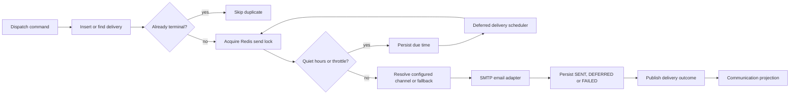

# Notification dispatcher

Executes queued external message delivery. It owns delivery attempts/status, defer/retry decisions and channel selection. Communication-service remains the owner of conversations, templates and user-facing message content.

## End-to-end design

## Rules and failure behavior

`insertOrGet` deduplicates incoming delivery commands. A terminal record is not sent again by ordinary redelivery. A Redis lock serializes sends for a message. Quiet hours and per-recipient notification throttling cause a persisted defer time; scheduled work resumes them later.

Channel adapters distinguish permanent and transient failures. Kafka-originated transient failures enter retry handling; scheduled transient failures use backoff and a configured maximum attempt count. If the requested channel is unconfigured, only a configured fallback may be used; otherwise the delivery becomes FAILED. SMTP is implemented. SMS/WhatsApp placeholders must not be advertised as working provider adapters.

There is still an unavoidable external-side-effect window: SMTP can accept a message before the process records SENT. Locks and terminal checks reduce duplicates, but do not prove exactly-once delivery across crashes. Recipients and operators must not treat a retry as a transactional rollback of an earlier SMTP send.

## REST endpoints

[Complete reference](notification-dispatcher-endpoints.md): **3 staff-only operations**.

| Method/path | Input | Result |
| --- | --- | --- |
| `GET /api/v1/deliveries` | Optional `status`; `limit=50`, clamped to 1–200 | `{data:[DeliveryView]}` scoped to tenant |
| `GET /api/v1/deliveries/{messageId}` | Tenant-owned message ID | Delivery view; no message body in the view |
| `POST /api/v1/deliveries/{messageId}/retry` | Staff; eligible delivery | Retry workflow and refreshed delivery view |

Valid status filters: `PENDING`, `DEFERRED`, `SENT`, `FAILED`. The view contains message/tenant identity, audience, requested/used channel, status/reason, attempts and due/created/updated timestamps. The service is primarily a Kafka worker, not a public send API.

## Components and patterns

| Component | Purpose |
| --- | --- |
| `DispatchCommandsListener` | Accept commands and handle retry exhaustion |
| `DispatchService` | Apply delivery state, quiet hours, throttles, channel/fallback and retry policy |
| `Delivery` | Model attempt and lifecycle state |
| `ChannelAdapter`, `SmtpEmailAdapter`, `UnconfiguredChannels` | Isolate transport implementations and explicit missing-provider behavior |
| `RedisDispatchGuards` | Distributed send lock and notification throttle |
| `MongoDeliveryStore` | Durable delivery state and outcome publication |
| `DeferredDeliveryScheduler` | Resume due work and purge eligible expired failed content |
| `DeliveryController` | Staff status visibility and operator retry |

Patterns: strategy/adapter, idempotent consumer, distributed lock, throttle, deferred work and bounded retry. Delivery-state retention and message-content retention are separate concerns.

Source: [service](../../notification-dispatcher/src/main/java/com/openhire/dispatch), [configuration](../../notification-dispatcher/src/main/resources/application.yml), [tests](../../notification-dispatcher/src/test). Configure SMTP credentials through secrets; a passing health endpoint does not prove external delivery.
