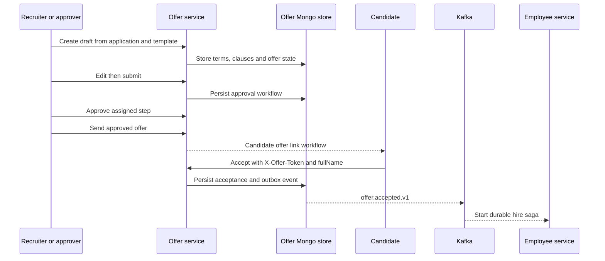

# Offer service

Owns offer terms, templates, reusable clauses, approval steps and candidate acceptance/decline/negotiation. It does not directly create employees and does not currently provide a certified third-party e-sign integration.

## End-to-end design

## Business rules

- Draft creation is tied to an application. Terms, cover note, template and clause data belong to the offer aggregate.
- Submission, step approval/rejection, sending and rescinding are explicit domain transitions. The caller cannot simply patch a status to bypass approval.
- Staff visibility and mutation authority are checked through `Viewers` and application/domain rules.
- Candidate actions use `X-Offer-Token`. The UI keeps link tokens in URL fragments so they are not included in proxy access paths. Receipt-based status uses `X-Application-Receipt` and `tenantId` instead.
- Acceptance includes a typed full name. This implemented acknowledgement is not a claim of provider-certified e-signature or legal signature compliance.
- `offer.accepted.v1` initiates an asynchronous employee saga. An accepted offer response does not guarantee that employee onboarding/HRIS processing has completed.

## REST endpoints and data

[Complete endpoint reference](offer-service-endpoints.md): **19 operations** with method-level contracts and recursively linked record fields.

| Family | Paths | Request / response |
| --- | --- | --- |
| Create/read by application | `POST/GET /api/v1/applications/{applicationId}/offer` | Optional `{templateKey,terms,coverNote}`; create returns 201 `OfferDetail` |
| List/read/edit | `GET /api/v1/offers?status=...`, `GET/PATCH /api/v1/offers/{id}` | Edit `{terms,coverNote}`; list returns `Page<OfferSummary>` |
| Workflow | `POST /api/v1/offers/{id}/submit`, `/send`, `/rescind` | Optional reason on rescind; updated detail |
| Approval | `POST /api/v1/offers/{id}/approvals/{stepId}/approve` or `/reject` | Reject accepts optional `{reason}` |
| Templates/clauses | `GET/PUT /api/v1/offer-templates...`, `/offer-clauses...` | Template `{name,body,clauseKeys}`; clause `{title,body}` |
| Candidate offer | `GET /api/v1/public/offers`; POST `/accept`, `/decline`, `/negotiate` | Header credential; bodies `{fullName}`, optional `{reason}`, `{message}` |
| Receipt status | `GET /api/v1/public/applications/{applicationId}/offer` | Receipt header plus tenantId query; restricted status view |

The exact `TermsInput` and `OfferDetail` fields are in the reference dictionary; do not reuse a UI summary as a complete edit request. Domain validation remains authoritative for compensation and dates.

## Components, patterns and purpose

| Component | Purpose |
| --- | --- |
| `OfferController`, `PublicOfferController` | Separate staff commands from token/receipt-bound candidate actions |
| `OfferApplicationService` | Coordinate templates, terms, transitions, candidate links and publication |
| Offer domain and repository ports | Model approval/offer invariants independent of HTTP |
| Mongo offer/template/clause adapters | Persist tenant-owned aggregates and reusable content |
| Application event listener | Observe lifecycle changes relevant to offers |
| Shared audit/outbox infrastructure | Record sensitive changes and publish committed lifecycle events |

Patterns: aggregate state machine, ports/adapters, optimistic concurrency, capability tokens, outbox and event-driven saga handoff. No cross-service database transaction is implied.

## Operations and boundaries

Keep token/signing secrets outside source control. Retry state-changing commands only after checking the current offer state. Employee/HRIS failures are investigated in the hire saga, not by accepting the offer again. External e-sign adapters remain provider-selection work; see [Phase 8](../PHASE_8_ENTERPRISE_RECOVERY.md). Source: [service](../../offer-service/src/main/java/com/openhire/offer), [configuration](../../offer-service/src/main/resources/application.yml), [tests](../../offer-service/src/test).
