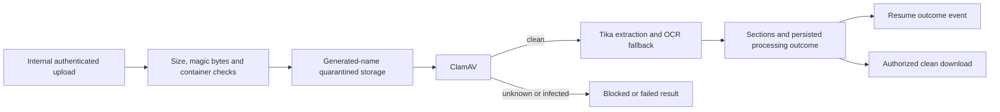

# Resume processor

## Current design and detailed contract

[Complete REST endpoint reference](resume-processor-endpoints.md) includes current request bindings, response DTOs and source links. See [platform end-to-end flows](END_TO_END_DESIGN.md) and [component purposes](SHARED_COMPONENTS.md). Older phase-specific verification notes below are historical; this documentation refresh does not claim new runtime acceptance.

Java 25 / Spring Boot 4.1.1, port 8086, MongoDB `oh_resume`, named Docker volume `resume-data`.

## Business logic and components

`ResumeController` accepts only secret-authenticated internal uploads, status queries and retries.
Recruiters can download a resume only after scanning and extraction succeed, in their own tenant.
`ResumePipeline` validates file contents, writes a generated-name quarantine object, creates a durable
processing record and runs bounded concurrent workers. Maximum upload is 10 MB; filenames are never
used as filesystem paths. IDs incorporate tenant, application and content digest.

Pipeline: magic bytes → ClamAV INSTREAM scan → Apache Tika text extraction → OCR fallback for sparse PDFs
→ section splitting → stored result/outbox. Unknown scanner results and scanner outages fail closed.
DOCX validation rejects traversal, excessive expanded size/entry counts, missing structure and VBA payloads.
Magic-byte validation is only the first stage, not proof a document is safe or parseable.

Tika 3.3.3 is embedded in the resume processor (PDF, Microsoft Office and OCR modules only).
`EmbeddedResumeTextExtractor` implements `ResumeTextExtractor`; no Tika HTTP server or `TIKA_URL` is used.
Tesseract runs as a child process in the same container. Both local and CI Dockerfiles install Tesseract
and English language data only for the resume-processor image; other service images do not include OCR.
ClamAV remains a separate scanner with its own signature volume and fail-closed behaviour.

For a Java run outside Docker, install Tesseract first (`brew install tesseract` on macOS, or
`apt-get install tesseract-ocr tesseract-ocr-eng` on Debian/Ubuntu), verify `tesseract --list-langs`, and
configure `CLAMAV_HOST`/`CLAMAV_PORT`. Text extraction does not need Tesseract, but an OCR-required resume
fails instead of pretending extraction succeeded when the engine or language data is unavailable.

| Environment setting | Default | Purpose |
|---|---|---|
| `RESUME_EXTRACTION_CONCURRENCY` | `1` | Worker/parser concurrency; permitted range 1–4 |
| `RESUME_EXTRACTION_TIMEOUT_SECONDS` | `80` | Caller deadline per text/OCR attempt (maximum 80 seconds) |
| `RESUME_EXTRACTION_MAX_PAGES` | `20` | Reject PDFs above this count (maximum configurable 50) |
| `RESUME_EXTRACTION_MAX_CHARACTERS` | `1000000` | Reject overflowing text, never persist truncation |
| `RESUME_OCR_TIMEOUT_SECONDS` | `30` | Tesseract timeout per page (maximum 30 seconds) |
| `RESUME_OCR_LANGUAGE` | `eng` | Installed language identifiers; extra data requires image changes |

OCR fallback is for PDFs with fewer than 30 extracted characters. Rendering uses 150 DPI and rejects
pages above 10 million estimated rendered pixels. Embedded document attachments are not recursively
parsed. The parser executor has fixed threads and a small bounded queue, separate from virtual-thread
pipeline workers. A timed-out parser is interrupted; if it ignores interruption it keeps occupying its
slot, rather than allowing unbounded replacement threads. Busy/timeouts participate in existing bounded
retry recovery; no timed-out result can release a quarantined resume.

In-process parsing is not a security sandbox: native/Java heap exhaustion or an uninterruptible parser
can still affect this service and require its restart. Keep container limits; use a separate extraction
process again if stronger production isolation is required. Compose retains the 768 MB memory limit,
reduces JVM heap share to 60% and defaults to one worker; this is not a guarantee every document fits.
Tesseract is restricted to one OpenMP thread. Tune only after representative load/OCR acceptance.

Workers claim records with an expiring lease. Failed records allow up to three attempts; infected records
cannot be retried into a clean state. A clean replacement uses the application's replacement-upload endpoint.
Expired exhausted leases become FAILED. Application polling sees failures even if event delivery is delayed.

Components: Spring MVC/Security, MongoTemplate, local filesystem volume, Java virtual-thread workers,
ClamAV socket adapter, embedded Tika extractor/native Tesseract, embedded Kafka outbox, Actuator.

## REST endpoints

All paths start with `/api/v1`.

| Method | Path | Behaviour |
|---|---|---|
| POST | `/internal/resumes` | Multipart `tenantId`, `applicationId`, `file`; validates and queues |
| GET | `/internal/resumes/{id}?tenantId=…` | Internal status, step outcomes, extracted text and sections |
| POST | `/internal/resumes/{id}/retry?tenantId=…` | Retry a FAILED record below attempt limit |
| GET | `/resumes/{id}/download` | Staff-only clean attachment; tenant from verified token |

Internal endpoints require `X-Internal-Service-Secret`. They are not public gateway routes.

## Patterns and storage

- Pipeline with explicit processing outcomes and human recovery instead of automatic rejection.
- Content-addressed idempotent upload and quarantined storage.
- Lease/worker-pool pattern with bounded extraction size, parser/OCR deadlines and retry count.
- Adapter boundaries around scanner and extractor protocols.
- Single-document result/outbox write; `resume.events.v1` carries status, not resume contents.

Storage is local-volume based, not S3. Back up `resume-data` together with `oh_resume`; moving to multiple
hosts requires shared object storage. This phase does not implement retention deletion or legal holds.
Unlinked objects from interrupted/competing uploads are retained, not automatically deleted.

## Verification

`ResumeValidationTest` sources cover file-size limits, PDF headers, DOCX structure, traversal and macros.
The recovery acceptance fixture injects extraction faults through the extractor port and runs its own
scanner socket; it does not test Tika/OCR itself. The owner must still run the live clean/corrupt/scanned/
malware fixtures against the rebuilt resume processor, including scanner outage and timeout recovery.
Historical external-Tika acceptance is not acceptance of this new embedded implementation.

Change validation (2026-10-24): the extractor and pipeline were compiled into a temporary directory,
not packaged as applications. A standalone synthetic smoke check passed PDF and DOCX text extraction,
real native Tesseract OCR of an image-only PDF, PDF page limits, output limits and corrupt-PDF rejection.
All 34 Node pipeline/deployment/configuration checks passed, package/endpoint checks passed, and normal
and local-no-scan Compose configuration validation passed. Dependency locks include compile, test and
Spring Boot production-runtime configurations. No application JAR/image build, live Mongo operation,
service restart or full Java acceptance suite was performed for this change.
