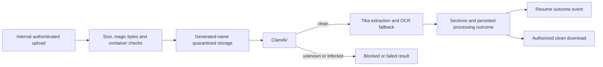

# Resume processor

## Current design and detailed contract

[Complete REST endpoint reference](resume-processor-endpoints.md) includes current request bindings, response DTOs and source links. See [platform end-to-end flows](END_TO_END_DESIGN.md) and [component purposes](SHARED_COMPONENTS.md). Older phase-specific verification notes below are historical; this documentation refresh does not claim new runtime acceptance.

Java 25 / Spring Boot 4.1.1, port 8086, MongoDB `oh_resume`, named Docker volume `resume-data`.

## Business logic and components

`ResumeController` accepts only secret-authenticated internal uploads, status queries and retries.
Recruiters can download a resume only after scanning and extraction succeed, in their own tenant.
`ResumePipeline` validates file contents, writes a generated-name quarantine object, creates a durable
processing record and runs bounded concurrent workers. Maximum upload is 10 MB; filenames are never
used as filesystem paths. IDs incorporate tenant, application and content digest.

Pipeline: magic bytes → ClamAV INSTREAM scan → Apache Tika text extraction → OCR fallback for sparse PDFs
→ section splitting → stored result/outbox. Unknown scanner results and scanner outages fail closed.
DOCX validation rejects traversal, excessive expanded size/entry counts, missing structure and VBA payloads.
Magic-byte validation is only the first stage, not proof a document is safe or parseable.

The full Tika Docker image supplies OCR. ClamAV maintains signatures in its own named volume; initial
signature download can take time. Neither parser nor scanner is published to a host port by Compose.
Local Java runs must provide `TIKA_URL`, `CLAMAV_HOST` and `CLAMAV_PORT` to separately running dependencies.

Workers claim records with an expiring lease. Failed records allow up to three attempts; infected records
cannot be retried into a clean state. A clean replacement uses the application's replacement-upload endpoint.
Expired exhausted leases become FAILED. Application polling sees failures even if event delivery is delayed.

Components: Spring MVC/Security, MongoTemplate, local filesystem volume, Java virtual-thread workers,
ClamAV socket adapter, bounded HTTP extraction adapter, embedded Kafka outbox, Actuator.

## REST endpoints

All paths start with `/api/v1`.

| Method | Path | Behaviour |
|---|---|---|
| POST | `/internal/resumes` | Multipart `tenantId`, `applicationId`, `file`; validates and queues |
| GET | `/internal/resumes/{id}?tenantId=…` | Internal status, step outcomes, extracted text and sections |
| POST | `/internal/resumes/{id}/retry?tenantId=…` | Retry a FAILED record below attempt limit |
| GET | `/resumes/{id}/download` | Staff-only clean attachment; tenant from verified token |

Internal endpoints require `X-Internal-Service-Secret`. They are not public gateway routes.

## Patterns and storage

- Pipeline with explicit processing outcomes and human recovery instead of automatic rejection.
- Content-addressed idempotent upload and quarantined storage.
- Lease/worker-pool pattern with bounded extraction size, network timeouts and retry count.
- Adapter boundaries around scanner and extractor protocols.
- Single-document result/outbox write; `resume.events.v1` carries status, not resume contents.

Storage is local-volume based, not S3. Back up `resume-data` together with `oh_resume`; moving to multiple
hosts requires shared object storage. This phase does not implement retention deletion or legal holds.
Unlinked objects from interrupted/competing uploads are retained, not automatically deleted.

## Verification

`ResumeValidationTest` sources cover file-size limits, PDF headers, DOCX structure, traversal and macros.
The owner must still run Java tests plus real clean/corrupt/scanned/malware fixtures against Tika/ClamAV,
including scanner outage and timeout recovery. No Java service or scanner has been started by the assistant.
