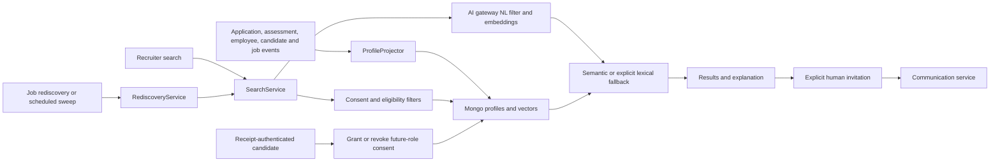

# Talent service

Owns the searchable talent-pool projection, rediscovery runs, ranking, invitations and future-role consent. It reads service-owned projections rather than treating a candidate's previous application as unlimited consent to future contact.

## End-to-end design

## Business logic

Profile projection consumes lifecycle facts and maintains searchable state. Search applies tenant/consent/eligibility constraints before ranking. Natural-language input is converted to editable filters by AI gateway; if that conversion is unavailable, the query is retained as meaning/text search. If embeddings are unavailable, lexical scoring is explicit rather than fabricated semantic certainty.

Rediscovery can refresh a job's suggestions and also runs through scheduled sweeps protected by a Redis lock. Inviting a candidate is a separate human action, not an automatic consequence of ranking. Invitation delivery goes through communication-service. Candidate consent is read/updated using the application's receipt credential; possession of an application ID alone does not authorize consent changes.

## REST endpoints

[Complete reference](talent-service-endpoints.md): **7 operations**, including `Filters`, search results and consent record details.

| Method/path | Request | Response / behavior |
| --- | --- | --- |
| `GET /api/v1/talent/rediscovery` | Staff; optional `jobId`, `refresh=false` | Suggestions for the selected job; refresh may perform work |
| `POST /api/v1/talent/search/nl` | `{query}` | Parsed filters/chips and ranked results |
| `POST /api/v1/talent/search` | `{filters,semanticQuery}` | Explicit-filter search |
| `GET /api/v1/talent/pool-health` | Staff | Talent-pool health view |
| `POST /api/v1/talent/{candidateId}/invite` | Optional `{jobId}`; staff | 204; explicit invitation use case |
| `GET /api/v1/public/applications/{applicationId}/talent-consent` | `tenantId`, `X-Application-Receipt` | Current consent |
| `PUT` same consent path | Same credentials; `{granted: boolean}` required | Persisted consent view |

Example natural-language request: `{"query":"Backend engineers with Java experience in Bengaluru"}`. Generated filters remain reviewable; the service does not silently turn them into protected-attribute requirements.

## Components, patterns and purpose

| Component | Purpose |
| --- | --- |
| `TalentController`, `PublicConsentController`, `Viewers` | Staff and candidate-credential API boundaries |
| `SearchService`, `ProfileFilter`, `Ranking`, `Vectors` | Eligibility filtering, ranking and lexical/vector fallback |
| `ProfileProjector` + Kafka listeners | Build/reconcile tenant projections from source events |
| `RediscoveryService`, `TalentScheduler`, `RedisSweepLock` | Job-focused rediscovery and coordinated scheduled sweeps |
| `InvitationService`, `ConsentService` | Separate permission-to-contact from explicit invitation commands |
| Mongo profile/vector/run/invitation adapters | Durable service-owned data |
| HTTP directories, AI gateway and messenger | Retrieve authoritative data, compute embeddings and request messages |

Patterns: CQRS/materialized projection, strategy/fallback ranking, ports/adapters, idempotent event handling and distributed scheduling lock. Projection freshness and provider availability affect results; there is no promise of instantaneous cross-service consistency.

Source: [service](../../talent-service/src/main/java/com/openhire/talent), [configuration](../../talent-service/src/main/resources/application.yml), [tests](../../talent-service/src/test). Review consent, privacy tombstones and stale projections when investigating an absent profile; do not bypass them to force a match.
